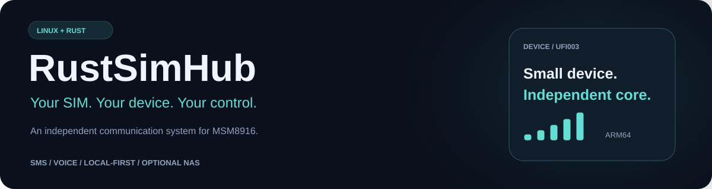
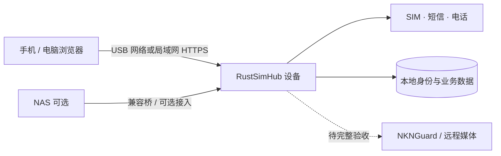
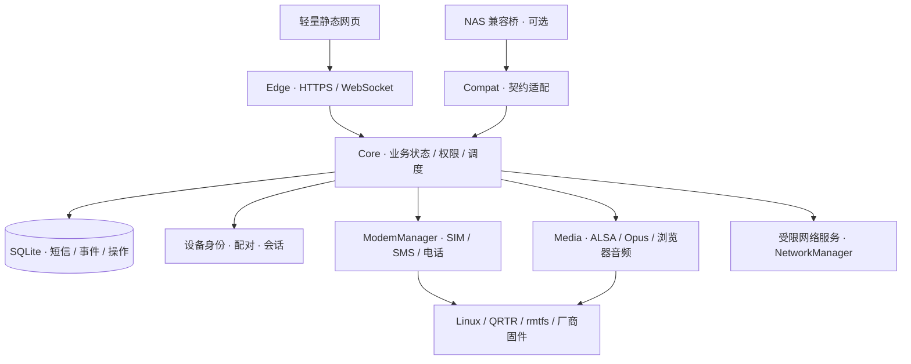

<div align="center">

# RustSimHub · 中文介绍



**让一张 SIM 卡，拥有独立运行的通信系统。**

Linux + Rust 用户态 · 短信 · 电话与双向语音 · 设备本地存储 · 可选 NAS 接入

[](https://github.com/Viper-Boss/RustSimHub/actions/workflows/rust.yml)
[](LICENSE)


[了解项目](#为什么做-rustsimhub) · [界面预览](#未来界面预览) · [功能进展](#功能与当前进展) · [本地开发](#本地开发) · [文档导航](#文档导航)

</div>

> **开发状态 · 2026-10-24**<br>
> 已有目标棒子的实机开发系统，原 P0–P7 里程碑整体约 **80%**。尚未形成可供其他设备直接刷写的正式发行版。下方前端效果图为未来设计，使用虚构数据；当前已交付网页以源码和验收记录为准。BLE、短信转发、NKNGuard 与使用统计作为扩展单独跟踪。

## 为什么做 RustSimHub

RustSimHub 面向 **Snapdragon 410 / MSM8916** 棒子，将 SIM、短信、电话、音频、权限和数据放在设备自身管理。首个目标板为 **UFI003_MB_V02**。

它希望让通信设备在完成设置后，仅接电源就能继续工作：通过已配置的网络访问网页、查看短信、接听与拨打电话，也可以按需接入 NAS。**核心业务在棒子上运行，NAS 是可选接入层。**

| 你关心的事 | RustSimHub 的设计 |
| --- | --- |
| NAS 关闭后还能不能用？ | 设备持有业务状态和数据；独立运行是产品目标，已有保存 Wi-Fi 的冷启动验证，完整独立首配仍在推进。 |
| 短信和权限保存在谁那里？ | 设备本地 SQLite 保存业务记录，Core 执行身份、配对、权限与撤销。 |
| 怎样访问？ | 当前重点是 USB / 局域网 HTTPS 网页；Wi-Fi、蜂窝数据和远程接入分别验证。 |
| 网络出问题会不会重复发送？ | 发送前持久化操作；结果不确定时保留 `Unknown`，先核对，禁止自动重发。 |
| “Rust 固件”覆盖哪些部分？ | Rust 负责核心业务与用户态服务；Linux、板级驱动、厂商固件及 ALSA / Opus 等组件保留各自实现。 |

## 未来界面预览

### 桌面控制台 · 一眼看清通信状态

以设备总览为首页，将 SIM 注册、短信、电话和连接路径放在同一屏。日常操作保持简洁，配网、权限和系统维护有独立入口。


### 手机网页 · 常用操作触手可及

手机端优先呈现总览、收件箱与拨号。采用响应式网页方向，保持同一套设备权限与操作回执。**原生手机客户端尚未开发。**


概念图采用中文界面。图内状态、消息、数量及时间均为虚构数据，不代表真实设备、性能结果或已上线服务。当前网页包含一键测试、日常电话、短信和网络配置；上面的视觉重设计尚未接入实际 API。

[查看前端设计说明、页面规划与交互状态 →](docs/frontend-vision.md)

## 功能与当前进展

以下是截至 2026-10-24 的文档快照。**源码验证、设备交付、用户验收和正式发布是不同阶段**；最新变化以[进度](docs/PROGRESS.md)、[接手说明](docs/HANDOFF.md)及各项验证记录为准。

| 模块 | 已有能力 / 证据 | 仍需完成 |
| --- | --- | --- |
| 设备身份与权限 | 本地 Owner 认领、签名配对、会话、撤销、受限 IPC、SQLite 持久化 | 持续安全审查与发行验收 |
| 短信 | 收件箱、正文、一次提交、结果核对、本地回收站；正式网页发送及运营商回复已有实机记录 | 多客户端同步与完整故障 / 恢复实机矩阵 |
| 电话与音频 | 拨出、来电、接听、挂断和浏览器声音；正式系统已验证真实双向说话 | 拒接 / DTMF 完整实测、竞争、长期稳定与远程 TURN |
| 网络与流量 | USB / Wi-Fi 访问、保存 Wi-Fi 冷启动、网络状态、月流量与限额阻断验证 | 无保存网络的首配、AP→STA 完整闭环、远程接入与更多网络组合 |
| NAS 兼容 | 已有只读会话桥、真实收件箱与历史迁移 / 查询验证 | 原 NAS 页面、PCM 与完整兼容 |
| 安装与更新 | 签名应用交付、正常升级、身份 / 短信保持、回退相关验证 | 通用刷写发行包、完整镜像恢复、故障启动与多设备验证 |
| 状态灯与网页 | Rust 灯控、轻量管理网页、一键测试入口已交付 | 全部真实业务灯效验收及本页展示的视觉重设计 |

### 正在拓展的方向

| 扩展 | 目标体验 | 当前边界 |
| --- | --- | --- |
| 短信转发 | 设备原生规则与队列，Webhook / Bark / Telegram 方向，独立总开关 | 规则、HTTPS 组件和 Core 管理接口已有源码验证；完整 worker、服务启停与网页仍未交付 |
| NKNGuard | 授权后的远程连接，展示直连 / 中继 / 不可达 | 待移植与实测；不能据此宣称远程电话已可用 |
| 使用统计 | 单独授权的近期活跃安装估计，明确统计窗口与更新时间 | 待实现；独立开关，不与远程接入或转发捆绑 |
| BLE 应急配网 | 无可用网络时的配置辅助入口 | 独立扩展任务；尚未完成或验收 |

详见[扩展任务](docs/FEATURE-EXTENSIONS-2026-10-24.md)与 [BLE 任务](docs/ble/README.md)。

## 怎样连接设备



- **USB / NAS**：设备处理通信，NAS 可承担管理、备份或接入。
- **Wi-Fi**：在已配置网络上独立提供网页；完整首次配网和热点切换仍在开发。
- **蜂窝数据**：需要用户明确授权，具备月流量策略；USB 或 Wi-Fi 失败不会隐式开启普通蜂窝数据。
- **仅供电、没有互联网**：SIM 注册、本地收短信与来电记录属于产品目标；远程通知和声音仍需要可用网络。独立运行不等于自动拥有公网地址。

## 系统架构



Core 是业务状态的权威来源。Edge 提供网络入口，硬件与高权限操作收敛到有限接口；不开放任意 shell、AT 或 QMI 执行 API。短信发送、SIM 代次和通话租约共同约束重复执行与跨卡串用。

| 层 | 技术与职责 |
| --- | --- |
| 设备系统 | Debian ARM64、Linux、systemd 与板级适配 |
| Rust 用户态 | 业务核心、身份权限、IPC、网络入口、更新恢复与受限服务 |
| 数据 | SQLite 事务、持久操作记录、事件与恢复 |
| 通信底层 | ModemManager、NetworkManager、QRTR、rmtfs |
| 媒体 | 隔离的 ALSA / Opus 媒体链路与浏览器音频 |
| 网页 | 随 Edge 提供的轻量 HTML / CSS / JavaScript；设备运行无需 Node.js |
| 构建工具 | Cargo、Python、Shell；网页回归使用 Node.js |

## 本地开发

### 1. 获取源码

```sh
git clone https://github.com/Viper-Boss/RustSimHub.git
cd RustSimHub
```

工具链由 [rust-toolchain.toml](rust-toolchain.toml) 固定为 Rust **1.98.0**，依赖由 `Cargo.lock` 锁定。

### 2. 验证核心代码

```sh
cargo test --workspace --locked
cargo run -p rustsimhub-core -- --self-check
cargo fmt --all -- --check
cargo clippy --workspace --all-targets --locked -- -D warnings
```

Linux 用于 D-Bus、服务、原生音频和硬件验证；Windows 可运行适用的纯规则与协议测试。原生音频是独立 workspace，Linux 上需安装 ALSA / Opus 开发依赖：

```sh
cargo test --manifest-path native/audio-alsa/Cargo.toml --locked
```

网页回归和板级夹具命令见 [CI 工作流](.github/workflows/rust.yml)。本地测试通过不代表已完成 ARM64、实机或发行验收。

### 3. 了解设备探测与安装

Linux 下 `rustsimhub-core --probe` 只读查询系统和 ModemManager 能力，不拨号、不发送短信、不切换无线电。

当前不提供通用“一键刷机”入口。安装前请阅读[硬件基线](docs/HARDWARE-BASELINE.md)、[首次安装](docs/initial-installation.md)与[剩余工作](docs/REMAINING-WORK-AND-CLAUDE-HANDOFF.md)。目标板、内核 / 模块、备份可读性和恢复路径都需要逐设备核对；已有实机结果不外推为所有 MSM8916 棒子或所有运营商支持。

## 路线图

| 阶段 | 重点 | 验收目标 |
| --- | --- | --- |
| 收敛核心通信 | 短信故障路径、电话动作与媒体稳定性 | 实机可重复验证，操作结果与基带一致 |
| 完成独立首配 | 无保存网络启动、受保护热点、Wi-Fi 试连与保存 | 从首次设置到断电重启形成闭环 |
| 重设计日常前端 | 总览、短信、电话、网络、权限和系统 | 保留确认与 Unknown 核对，完成手机 / 桌面验收 |
| 逐项接入扩展 | 转发、NKNGuard、使用统计、BLE | 各自开关、失败状态、关闭行为与实机验证 |
| 准备正式发行 | 安装、备份、更新、恢复、多设备与长期运行 | 可追溯制品与明确兼容范围 |

权重与分数见 [PROGRESS-SCALE](docs/PROGRESS-SCALE.md)。界面设计稿和扩展计划不增加硬件验收分数；路线图不承诺发布日期。

## 文档导航

| 想了解什么 | 阅读入口 |
| --- | --- |
| 最新进度与验收 | [开发进度](docs/PROGRESS.md) · [固定量表](docs/PROGRESS-SCALE.md) · [接手说明](docs/HANDOFF.md) |
| 规划与剩余任务 | [开发计划](docs/development-plan.md) · [剩余工作](docs/REMAINING-WORK-AND-CLAUDE-HANDOFF.md) |
| 前端未来形态 | [前端设计与交互说明](docs/frontend-vision.md) |
| 身份、存储与恢复 | [身份鉴权](docs/auth.md) · [SQLite](docs/storage.md) · [恢复与 CLI](docs/recovery-clients.md) |
| 短信与事件 | [SIM / 收件箱](docs/sim-inbox.md) · [发送](docs/sms-send.md) · [事件订阅](docs/observer-events.md) |
| 电话与媒体 | [通话控制](docs/call-control.md) · [媒体授权](docs/media-authorization.md) · [网页媒体](docs/web-media.md) |
| 网络与 NAS | [Wi-Fi 配置](docs/wifi-provisioning.md) · [网络诊断](docs/network-diagnostics.md) · [NAS 桥](docs/nas-online-bridge.md) |
| 安装与系统 | [固件目录](firmware/README.md) · [首次安装](docs/initial-installation.md) · [内核来源](docs/KERNEL-PROVENANCE.md) |
| 新功能 | [转发 / NKNGuard / 统计](docs/FEATURE-EXTENSIONS-2026-10-24.md) · [BLE](docs/ble/README.md) |

部分文档记录的是特定阶段快照。判断现状时，优先查看最新进度和对应 `VALIDATION-*` 记录。

## 参与贡献

欢迎通过 [Issues](https://github.com/Viper-Boss/RustSimHub/issues) 提交兼容性反馈、文档建议或功能讨论，通过 Pull Request 提交改动。开发前阅读 [AGENTS.md](AGENTS.md) 与接手说明。

反馈请附脱敏后的板型、版本、复现步骤、预期与实际结果。凭据、SIM 标识、短信正文、联系人和原始硬件日志不进入公共仓库；本地调试材料存入 `.private/` 或 `.local/`。

## 许可证与来源

项目采用 [GNU AGPL-3.0-only](LICENSE)。Linux、厂商固件及第三方组件保留各自许可证；分发时需逐项核对。

项目借鉴 [AirSimHub](https://github.com/Viper-Boss/AirSimHub) 的设备适配经验及 NasSimHub 的通信业务实践。NAS 适配涉及的既有 Go 服务保持其真实来源与语言归属。概念图由仓库内 [Python 脚本](docs/assets/generate-preview.py) 生成，SVG 可直接编辑和重建。
