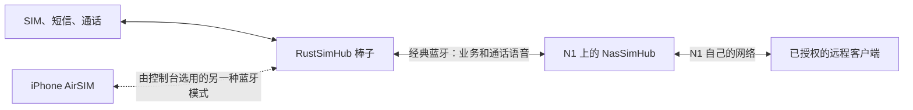

# RustSimHub 与 NasSimHub 的蓝牙业务连接

范围：棒子与 N1 上的 NasSimHub 直接配对，通过蓝牙交换设备业务数据和双向实时通话语音。N1 用自己的以太网或 Wi-Fi 提供现有 NasSimHub 对外服务。棒子需要供电，数据线无需插到 N1。2026-11-16 完成设计和只读预检工具，尚未实现或部署生产链路。

## 蓝牙连接

采用经典蓝牙 BR/EDR 的应用专用配置，由 BlueZ 管理配对和连接。棒子注册两个独立的服务标识，N1 主动连接。第一版在两条 RFCOMM 连接上验证真实吞吐和延迟。BlueZ 通过 [ProfileManager1](https://github.com/bluez/bluez/blob/5.82/doc/org.bluez.ProfileManager.rst) 注册配置，并通过 [Profile1.NewConnection](https://github.com/bluez/bluez/blob/5.82/doc/org.bluez.Profile.rst) 将已配对连接交给应用。

- **业务连接**负责设备/线路状态、已授权的短信与通话记录、通话事件和本次通话所需的控制。沿用 Core 的业务权限、稳定 ID、分页游标、幂等键和租约。先接入现有 NAS 只读数据契约，再对接 NasSimHub 的设备适配层。短信发送/删除等写权限无需为蓝牙连接自动开放。
- **语音连接**只在该 NAS 持有本次通话和媒体授权时收发语音。复用棒子的现有 PCM 媒体进程和 NasSimHub 的远程通话管线。优先用 16 kHz 单声道、20 ms 帧、约 12–16 kbit/s Opus 验证双向通话。双方协商同一种格式。语音队列最多保留少量新帧，超时丢弃；传输长时间堵塞就关闭当前媒体流并报告状态。必要时对比应用专用经典蓝牙 L2CAP，保持相同业务边界。

两条连接均使用传输加密和明确的对端身份。第一次配对由两台设备确认同一蓝牙配对码，并由棒子所有者另行批准 N1 的应用公钥。应用凭据仅来自各自设备，保持 NAS 与 AirSIM 两组配对分离。每次连接核对保存的 N1 身份与授权代次。两条连接绑定同一应用会话；语音还绑定 Core 的实际通话编号和本次媒体许可。换绑、撤销、断线或切换模式时关闭有关连接，失去通信的通话由现有 Core 租约规则收尾。不信任 MAC 地址、设备名或 Bluetooth 系统配对结果作为业务授权。

## 不转发上网流量

蓝牙进程只接受固定业务请求和音频帧。使用传入的蓝牙连接及已限定的本机 IPC 套接字，避免为对端提供任意地址、端口或命令。无 PAN/NAP、IP 网卡、默认路由、DNS 服务、NAT、代理、TUN/TAP 或蜂窝 APN 接线。即使 N1 本身运行 Docker、VPN 或有现成全局转发规则，这条蓝牙连接也没有可由系统路由的网络接口。N1 对外只走 NasSimHub 已配置的应用服务，保持其原有登录和访问控制。

## 控制台互斥切换

在棒子控制台的蓝牙页增加一个「业务蓝牙用途」选择。现有 Wi-Fi 首次配网仍用原来的独立入口，不放进这两个选项。

| 选项 | 切换成功后的行为 |
| --- | --- |
| AirSIM 手机蓝牙 | 原有手机看到 RustSIM 并能按原协议重连。NasSimHub 蓝牙服务停止。 |
| NasSimHub 蓝牙 | 棒子接受已批准 N1 的业务和语音连接。AirSIM 蓝牙通话服务停止。 |

由棒子持久化选择，网页只显示后端实际启用的模式和独立的“未配对／已配对／已连接”状态。升级保留现有 AirSIM 选择和已保存的配对。仅设备所有者能切换或打开限时配对窗口。通话占用期间拒绝切换。无通话时暂时封住新的蓝牙通话请求，注销旧服务并确认其连接已关闭，再启动新服务。只有新服务注册成功才保存选择；失败时尝试恢复原模式，若无法确认两者的状态则关闭两边并显示故障。配对凭据不因模式切换而删除；设备重启只启动已保存的一个模式，不能用浏览器本地状态作为开关。

## 验收和实施顺序

1. 在棒子和真正的 N1 上运行 `python3 tools/system/probe-nas-bluetooth.py`。查看内置控制器、BR/EDR、RFCOMM 驱动和 BlueZ 配置接口。主线 Linux [N1 设备树](https://github.com/torvalds/linux/blob/master/arch/arm64/boot/dts/amlogic/meson-gxl-s905d-phicomm-n1.dts) 定义了内置蓝牙，还需要实际系统、设备树和固件都把它驱动起来。现有维护地址回读为 OneThingCloud OEC，不能作为 N1 的现场证据。
2. 接通两条应用蓝牙连接，验证双方批准、取消、撤销、断开重连和重启恢复。USB 数据线拔掉后，NasSimHub 应仍能拿到新的授权状态、短信和通话记录。用合成记录确认分页、重复和越权拒绝。
3. 接线到正式 Core 租约和媒体授权。实机拨出、接听并双向说话，测完整帧率、延迟和掉线恢复；每方向目标 50 个 20 ms 帧/秒，按独立声学回环测量该蓝牙链路增量延迟目标 p95 小于 150 ms。受并发短信读取或重连干扰时仍需如实报告掉帧。蓝牙断开或撤权后媒体立即停送，过期音频不得在重连后补发。
4. 浏览器验证互斥切换、双击、两个所有者会话并发、通话时拒绝切换、设备重启和切换失败回退。在两端核对没有新增 IP 接口或默认路由；尝试让 N1 经该连接访问非业务目标，必须失败。只使用本地合成目标验证隔离，不启用蜂窝数据。

现有 [NAS 在线接入桥](../nas-online-bridge.md) 和 [NAS 通话控制与媒体候选](../../tools/nas-adapter/control/README.md) 提供可复用的授权和业务契约。旧客户端不会因为传输层改成蓝牙就自动获得实时语音支持。NasSimHub 需要接入新传输适配器并完成双端验收。
