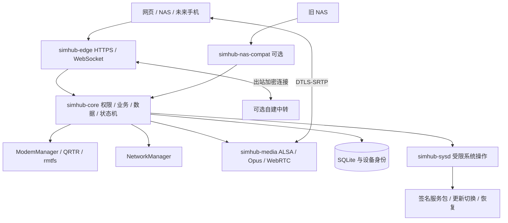

# Rust 独立 SIM 通信固件开发计划

版本：v0.1｜日期：2026-10-11｜状态：设计方案，尚未实施

适用项目：结合 NasSimHub 的通信业务能力与 AirSimHub 的设备适配经验，开发可直接安装在 Snapdragon 410 / MSM8916 棒子上的完整 Linux 系统。

首个目标板：UFI003_MB_V02。项目名称已确定为 RustSimHub；本文中的 `simhub-*` 和 `simhub-rs` 是原设计占位名称，实际实现名称以仓库源码为准。当前实现状态见 PROGRESS.md。

## 目录

1. [目标与完成标准](#1-目标与完成标准)
2. [已有基础与证据边界](#2-已有基础与证据边界)
3. [技术栈与总体架构](#3-技术栈与总体架构)
4. [模块开发规格](#4-模块开发规格)
5. [统一接口契约](#5-统一接口契约)
6. [数据库与持久化布局](#6-数据库与持久化布局)
7. [网络与远程访问设计](#7-网络与远程访问设计)
8. [启动恢复与更新设计](#8-启动恢复与更新设计)
9. [安全与权限约束](#9-安全与权限约束)
10. [资源预算与性能验证](#10-资源预算与性能验证)
11. [仓库与构建流程](#11-仓库与构建流程)
12. [阶段计划与工作包](#12-阶段计划与工作包)
13. [测试矩阵与发布门槛](#13-测试矩阵与发布门槛)
14. [待验证决策与后续扩展](#14-待验证决策与后续扩展)
15. [实现前阅读资料](#15-实现前阅读资料)

## 1. 目标与完成标准

### 1.1 产品目标

设备完成首次设置后，仅接电源即可启动，自动恢复 SIM、通信服务与用户选择的网络。无需 NAS 在线，已授权客户端可以查看短信、发短信、拨号、接听、挂断和进行双向语音。

设备通过以下链路提供同一套业务能力：

| 使用方式 | 设备承担的工作 | 其他端承担的工作 |
|---|---|---|
| USB 接 NAS | SIM、短信、真实通话状态、音频、权限、存储 | NAS 管理、可选备份、可选互联网出口和中转 |
| Wi-Fi 接路由器 | 独立联网、局域网接口、可选远程连接 | 手机/电脑访问；路由器提供互联网 |
| 蜂窝数据联网 | 独立拨数据、远程连接、流量限制 | 客户端及必要的远程中转 |
| 仅供电且无互联网 | SIM 注册、收短信、记录来电、本地维护 | 客户端暂不能远程收到通知或声音 |

“独立运行”意味着业务不依赖 NAS；不意味着设备天然拥有公网地址，也不意味着未配置网络时可以远程访问。第一次使用仍需通过 USB 或受保护的配网热点设置所有者、网络和流量授权。

### 1.2 首版范围

- 单设备、单 SIM、一个活动通话、一个活动媒体接收端。
- 完整安装系统：匹配的 boot/内核/模块、Debian rootfs、设备固件加载、持久化数据、Rust 服务、网页与恢复工具。
- 短信收发、通话记录、拨出/来电/接听/拒接/挂断/DTMF、双向音频。
- USB、Wi-Fi 客户端、受保护配网热点、用户明确允许的蜂窝数据。
- 本机所有者与客户端配对，设备本地执行权限。
- 局域网访问、远程信令及 TURN 媒体中继验证。
- 应用服务包签名更新、故障回退；整机系统升级按引导器实测结果确定方式。
- 小型网页用于管理和验收；手机原生 App 暂不开发。
- 兼容现有 NAS 的必要接口，不在棒子上复制 NAS 的多用户门户、AI 或全部插件。

首版不做：多路通话、会议、呼叫转移、eSIM 管理、蓝牙音频、GNSS 产品功能、AI 接听、流量代理、Docker 插件、视频或完整 NAS 重写。录音列为可选后续项，默认关闭。

### 1.3 核心验收场景

1. NAS 关闭，设备完全断电再上电。
2. 已配置 Wi-Fi 或已授权蜂窝数据自动恢复，设备身份和客户端授权不变。
3. 测试客户端读取已有短信、收到新短信，并成功发送测试短信。
4. 拨出与来电均完成双向声音、DTMF 和挂断；网页状态与基带一致。
5. 网络中断后，短信补同步且不重复发送；媒体连接按明确规则恢复或结束。
6. 应用更新失败可回到旧版本，身份、短信和授权保持；恢复工具可使用。

这些必须在目标板与明确记录的 SIM/运营商组合上实测。编译通过、模拟器通过、IMS 注册以及有下行 PCM 都不能单独替代这组验收。

## 2. 已有基础与证据边界

本文依据本工作区当前源码和文档梳理，没有在编写计划时连接棒子重新测量。旧文档存在版本滞后，必须在第一阶段形成一份新的统一证据清单。

| 已有基础 | 当前证据 | 新项目处理 |
|---|---|---|
| UFI003 / Debian arm64 / Linux 6.12.49-msm8916 | 本地 README、r138 硬件记录 | 优先沿用；固定精确源码、补丁、boot 与模块哈希 |
| USB NCM、2.4 GHz WPA2/混合模式 Wi-Fi | 单设备验收记录 | 保留经验，重新验证新服务和新镜像 |
| 中文短信、特定电信 SIM 双向通话 | README 与后续部署记录 | 提取行为规格及回归用例，Rust 独立验收 |
| 联通 46009 的 PS 优先运行时适配 | 2026-10-11 文档；控制与下行 PCM 已验证 | 双向声音与短信仍需补测，不推广为全部联通卡支持 |
| 配网热点、通用 Factory 与 OTA | 源码存在，但完整实机闭环未验证 | 当作待开发/待验收工作 |
| rootfs 默认锁 | 仍有 unresolved/null 字段 | 正式构建前重新解析并审核，禁止使用模板发布 |
| 独立管理后台 | 系统管理、网络、短信入口已有 | 新增完整独立电话与媒体能力 |
| 旧 NAS 信任策略 | 存在重启后 NAS 续确认的规则 | 改为设备所有者授权，旧策略仅可在兼容范围内收紧权限 |

重点本地依据：

- [AirSimHub README](https://github.com/Viper-Boss/AirSimHub/blob/main/README.md)
- [r138 硬件验证](https://github.com/Viper-Boss/AirSimHub/blob/main/docs/HARDWARE-R138.md)
- [联通语音适配](https://github.com/Viper-Boss/AirSimHub/blob/main/docs/UNICOM-VOICE.md)
- [rootfs 构建](https://github.com/Viper-Boss/AirSimHub/blob/main/docs/ROOTFS-BUILD.md)
- [已有 Node 协议](https://github.com/Viper-Boss/AirSimHub/blob/main/node/proto/compat.go)
- [已有媒体会话](https://github.com/Viper-Boss/AirSimHub/blob/main/node/agent/internal/voicemedia/server.go)

## 3. 技术栈与总体架构

### 3.1 语言和组件选择

| 层/功能 | 选择 | 原因与限制 |
|---|---|---|
| 启动、内核、设备树、DSP 音频驱动 | 已验证 Linux C/设备树/既有 bootloader | 首版不重写；必须匹配同一内核与模块 |
| 基带和 Wi-Fi 固件 | 设备自有厂商固件 | 不用 Rust 替代，不改变 NV/校准 |
| 系统 | 精简 Debian arm64、systemd | 先沿用已有板级基础；实际包集与版本需要锁定 |
| SIM/短信/通话底层 | ModemManager、libqmi、QRTR、rmtfs | Rust 经 D-Bus 使用；厂家扩展单独隔离 |
| 网络底层 | NetworkManager、wpa_supplicant | Rust 经 D-Bus 管理，不与别的网络管理器重复控制 |
| 核心业务与后台服务 | Rust，Tokio、serde、zbus | 状态机、并发控制、类型化接口 |
| HTTP/WS/TLS | Rust，axum、tower、rustls | 网络入口与通信核心分进程 |
| 数据 | SQLite，经 rusqlite 使用 | 单写入者、事务、迁移、断电恢复；SQLite 本身是 C |
| 设备音频 | Rust ALSA 封装＋libasound | ALSA/FFI 限定在媒体进程 |
| 编解码 | libopus，经受限 Rust 封装使用 | 首版不自行实现 Opus；FFI 纳入依赖审查 |
| WebRTC | 优先验证 webrtc-rs；str0m 为备选 | 选型前做 ARM64 双向音频、TURN、CPU/内存 PoC |
| 管理网页 | TypeScript＋轻量静态页面，Vite 构建 | 设备不运行 Node.js；不引入大型前端运行时 |
| 构建、镜像、发布辅助 | Python 3＋少量 POSIX shell | 明确输入、检查哈希、生成清单；不把 shell 当远程执行接口 |
| NAS 兼容 | Rust 兼容服务；NAS 最小适配暂沿用 Go | 不同时重写整个 NAS；翻译协议但不绕过新权限 |
| 移动 App | 首版不实现 | 预留 API、事件、WebRTC 和配对契约 |

以上依赖为选型建议，不是已冻结版本。PoC 通过后固定 Rust 工具链、Cargo.lock、Debian 包集、第三方 C 库与内核制品。参考最新文档时也要核对目标设备安装版本，不能直接按上游 main 假定方法存在。

### 3.2 进程布局

采用少量进程隔离主要信任边界，核心内部按模块组织，不把每个模块都变成独立服务。



| 进程 | 身份 | 可接触的数据/设备 | 不能做的事 |
|---|---|---|---|
| `simhub-core` | 固定非 root 用户 `simhub-core` | 唯一业务 DB 写入者、身份签名、限定 MM/NM D-Bus 调用 | 不直接操作块设备，不提供 shell，不监听公网 |
| `simhub-edge` | `simhub-edge` | HTTPS 私钥、连接和短暂请求缓冲 | 不打开业务 DB、ALSA、ModemManager 或系统控制 socket |
| `simhub-media` | `simhub-media` | 精确许可的 ALSA 节点、活动媒体授权、UDP/TURN | 不读短信/联系人/设备身份私钥，不拨号、不发短信 |
| `simhub-sysd` | root，限能力/路径 | USB gadget、灯、服务包切换、固定服务控制等必要操作 | 不监听 TCP、不接受任意命令/路径，不访问 NV/校准分区 |
| `simhub-nas-compat` | `simhub-compat`，可选 | 旧协议会话、短暂 PCM 转发 | 不直接读写 modem，不打开 DB，不持有所有者权限 |
| MM/NM/rmtfs 等 | 系统组件身份 | 各自硬件管理 | 不让自研服务重复接管其资源 |

安全含义：edge 被攻破仍可能滥用它看到的当前用户会话，但不因此获得所有用户、root 或设备签名私钥。core 是可信业务边界，若 core 被攻破，业务授权可能被破坏；sysd 的固定操作集合继续限制其系统级影响。不能把分进程描述为能够抵挡已取得 root 权限的攻击者。

## 4. 模块开发规格

以下 M00—M17 是逻辑模块。每个模块交付代码、接口说明、失败行为、针对关键风险的测试和验收记录。

### M00：板级能力与启动适配

**语言/位置**：Python 构建工具、少量启动 shell、内核 C/设备树；`board/ufi003-mb-v02/` 与 `firmware/`。

**实现**：先只读收集设备树 compatible、分区名称与大小、RAM、eMMC、boot 格式、内核 release/vermagic、remoteproc、声卡、Wi-Fi 模式和固件加载路径。生成 `board-manifest.json` 和私有设备报告；报告中不放 NV 内容、私钥、短信或完整 SIM 标识。

**边界**：板型清单只描述非秘密板级常量。设备唯一资料存在本机私有区域。禁止猜分区号，禁止把第一台设备整盘快照当通用固件，禁止跨板刷写。

**接口**：其他模块只消费 `HardwareProfile`：板型、可用硬件、内核与音频 profile 版本。动态能力由 M02/M05/M07 报告，不从芯片规格推定。

**验收**：旧系统可恢复；新系统冷启动与重启；USB、Wi-Fi、基带和声卡出现；确认固件加载在 radio 启动前完成。最先沿用既有验证组合，之后才能优化内核或裁包。

### M01：核心运行时与领域模型

**语言/位置**：Rust；`simhub-core`、`crates/domain`、`crates/core`。

**实现**：以单写者 actor 管理每条 SIM 线路的状态，使用有界队列。领域类型至少包含 `DeviceId`、`LineId`、`SimEpoch`、`CallId`、`OperationId`、`PrincipalId`、`PolicyGeneration`、`BootId`。外部传入的 ID 不能直接成为 D-Bus 对象路径或文件路径。

**边界**：HTTP DTO、旧协议 DTO 和领域模型分开。业务层通过 `ModemBackend`、`NetworkBackend`、`MediaController`、`Store` trait 调用适配器，不包含 socket、shell 或厂家专用 TLV。凭据只能由 M03 验证后形成不可伪造的内部 `AuthorizedContext`；不能相信 edge 传入的角色字段。

**接口**：类型化 `Command -> Result/Operation`、`Event -> EventLog`。给有副作用的命令建立 `accepted / running / succeeded / failed / unknown` 结果模型；请求取消不等于已经提交给 modem 的操作取消。

**验收**：并发拨号只接受一个；队列满返回明确错误；core 重启后先对账而非再次执行旧命令；所有授权入口均调用同一策略引擎。

### M02：SIM、基带与运营商适配

**语言/位置**：Rust `zbus`；`crates/modem-mm`。必要的厂家扩展单独放 `crates/carrier-qmi`，可暂保留小型既有适配程序供对照。

**实现**：连接系统 D-Bus 服务 `org.freedesktop.ModemManager1`，使用 ObjectManager 获取对象，订阅对象与属性变化。绑定当前真实 Modem/SIM；MM 重启后重新枚举，不能缓存旧路径一直用。读取 SIM 状态、注册状态、信号、设备能力和可获得的本机号码。

**边界**：只有 MM 管理主 modem 会话。常规业务不直接发 AT/QMI。必须使用厂家扩展时，经已核实的 qmi-proxy 或板级适配器串行调用，具有 client 生命周期、超时和结果检查；不得并行开启另一套 modem 管理器。SIM PIN 只在明确解锁请求时提交，失败不自动反复尝试。换卡生成新 `SimEpoch`，终止旧卡的待发送任务和媒体授权。

**接口**：`ModemSnapshot`、`SimChanged`、`RegistrationChanged`、`CapabilitiesChanged`；敏感 ICCID/IMSI 默认不向 API 返回。能力结构包含 `supported: yes/no/unknown`、`verification: untested/verified`、`available_now`、原因和证据版本，区分“支持”“已验证”“当前可用”。

**运营商插件**：将已有联通 PS 优先策略做成明确板型/基带/运营商的运行时 profile；仅在无通话且用户选择启用时应用，保留回退。未知组合只读，不改 MBN/PDC/NV/频段，不把 IMS 注册等同于双向音频。

**验收**：无 SIM、PIN 锁定、换卡、无信号、MM 重启、属性缺失、数据和通话并存；为不同卡单独记录短信与双向声音证据。

### M03：所有者、设备身份、客户端与权限

**语言/位置**：Rust；`crates/auth`、`crates/policy`，运行于 core。

**实现**：首启利用 OS 随机源生成每设备 Ed25519 身份及独立 HTTPS 密钥；身份与 IP、MAC、SIM 无关。设备所有者保存在本地，NAS/手机/网页分别授权。长期客户端公钥持久化，短期会话使用随机 opaque token，设备只保存 token 摘要。密码使用 Argon2id；参数在目标板测量后冻结，限制并发验证，避免耗尽内存。

**边界**：所有者、普通客户端、NAS 兼容客户端、Linux SSH 用户相互独立。scope 最少为 `status.read`、`sms.read`、`sms.send`、`calls.read`、`calls.control`、`media.use`、`network.manage`、`clients.manage`、`update.manage`、`system.manage`。NAS 默认只有被授予的 scope；允许它收紧自身 scope 内的策略，不允许它替代本地所有者或停掉其他客户端的服务。

**接口**：配对 challenge 绑定 device/client 公钥、随机 nonce、权限请求和会话 transcript；用双方签名证明密钥持有，所有者另行批准。持久策略使用递增 generation，撤销立即使当前会话和媒体票据无效。

**时间**：重启后长期授权仍有效；短期会话/租约/配对窗口全部失效，以 boot_id＋单调时钟约束。授权不依赖 NAS 每天续签。无 RTC 的校时和证书启动问题单独处理，不允许全局跳过 TLS 校验。

**初始参数**：认证挑战60秒、配对窗口5分钟、native会话15分钟；客户端到期后用已授权公钥重新证明身份。网页会话空闲30分钟失效、最长12小时；高风险动作的密码/密钥再次证明最多复用5分钟。所有参数配置有上下限，先测体验和目标板成本再冻结，不允许客户端指定无限有效期。

**验收**：离线重启后可再次认证；重放、越权、撤销、换卡观察期、错误时钟均符合规格；日志和诊断无秘密；USB 插入不能自动授予所有者。

### M04：短信服务

**语言/位置**：Rust；`crates/sms`，经 M02 和 M10 工作。

**实现**：使用 MM `Modem.Messaging` 的 List/Create/Delete 与 Added/Deleted 信号，以及 `Sms` 的属性和 Send。完整接收后一次事务写入短信及事件；半条/接收中信息保留状态，重启后重新查询。正常路径直接使用 D-Bus 字符串，不重复解码 UTF-8；兼容旧 mmcli 转义仅在导入边界处理。

**边界**：API 的“已接受”不表示运营商已发送或收件人已收到。发送前持久化操作及幂等键，之后提交 modem；在提交与保存结果之间断电时，结果标为 unknown，并尝试按已保存的 modem 对象对账。无法证明未发送时禁止自动重发，允许用户明确发起新操作。短信正文与号码不得写常规日志。

**去重**：保存设备内 SMS 对象关联与接收事务状态；重启后按 SIM epoch、方向、号码、原始时间、正文等生成候选关联，并保留歧义。不能仅凭正文相同丢弃新的短信。旧 SIM 短信可查看，但旧 SIM 的 outbox 永不转交新 SIM 自动执行。

**接口**：分页列表、正文、已读/删除/归档、发送 `Operation`、状态事件；长短信编码、分段和投递报告以 MM 的实际能力为准。客户端删除默认是本地 tombstone，删除 SIM/modem 存储是明确独立动作。

**验收**：中文、emoji、字面反斜杠、长短信、重复正文、部分接收、磁盘满、发送超时、发送中断电和 SIM 存储满。只有本地持久化成功且符合用户保留策略后，才清理 modem 存储。

### M05：通话控制与控制权

**语言/位置**：Rust；`crates/calls`；状态和控制在 core。

**实现**：MM `Modem.Voice.CreateCall` 创建对象，`Call.Start/Accept/Hangup/SendDtmf` 执行动作；订阅 CallAdded/CallDeleted、StateChanged/属性。启动或重连时 ListCalls 对账一次，后续查询目标对象，避免遍历全部历史呼叫。[MM 接口依据](https://github.com/linux-mobile-broadband/ModemManager/tree/main/introspection)

**状态**：`idle -> outgoing_pending -> dialing -> ringing_out -> active -> terminating -> ended`；来电为 `ringing_in -> active/ended`；查询失败为 `reconciling`，不能伪造 ended。记录 modem state/reason 和领域状态。`media_state` 独立为 none/starting/ready/degraded/failed，控制 active 不代表声音正常。

**控制权**：core 原子建立每通话租约：principal、call_id、boot_id、epoch、单调时间截止点。建议初始租约 30 秒，每 10 秒续期，真机后调整。其他客户端可看到来电，但同时接听只有一个成功；返回 `CALL_OWNED`。媒体必须绑定相同租约 epoch。

**失败规则**：拨号超时先对账，禁止自动再次拨号。DTMF 结果不确定不重发。控制或媒体失联先允许短暂恢复；宽限期结束后撤销媒体并请求 Hangup，实际基带是否结束仍继续确认。core 重启后撤销旧租约；如发现遗留活动通话，首版在有限恢复窗口后尝试挂断并记录原因，不自动向其他人放送音频。

**接口**：拨号/接听/拒接/挂断/DTMF、目标通话查询、租约续期、控制转交（首版不开放转交）、媒体创建授权。手动挂断作为高优先级命令，不能被统计采样或下载任务阻塞。

**验收**：并发拨号/接听、客户端崩溃、远端挂断、SIM 拔出、core/MM 重启、D-Bus 超时、挂断失败、无音频以及 DTMF 真机菜单。首版不声明紧急呼叫能力，不以紧急号码做开发测试。

### M06：ALSA 与通话 PCM

**语言/位置**：Rust＋libasound；`crates/audio-alsa`，只在 media 进程。

**实现**：按已经验证的 APR/QDSP6/q6voice 路由建立板级音频 profile，核实录音/注入伪端口和 mixer 控件。初始格式使用已记录的 S16LE、16 kHz、单声道、20 ms 帧；每方向 640 字节。驱动不支持时报告具体格式/路由错误，不擅自用物理麦克风口替代。

**边界**：media 只获得匹配声卡的必要设备节点，避免加入能访问全部音频设备的泛化组。应用层无新增 unsafe 为目标；FFI 封装集中，记录生命周期、线程安全和缓冲区契约。ALSA 阻塞 I/O 在独立线程或 poll 循环，不堵塞 Tokio 控制线程。

**接口**：`open(profile, authorization)`、`read_frame`、`write_frame`、`close`；预分配环形缓冲，有界队列，关闭必须能中断阻塞。采样时间使用单调时钟。下行与上行统计为 RMS、峰值、丢帧和 xrun，无需保存声音内容。

**验收**：真实双向声音、无静音路径错误、反复开关 PCM 后无泄漏；挂断/客户端撤销后释放设备；xrun 恢复有次数限制；16 kHz PCM 不作为 AMR-WB/EVS 的证据。

### M07：Opus、WebRTC 与媒体会话

**语言/位置**：Rust＋libopus；`crates/media`、`crates/webrtc-adapter`；进程 `simhub-media`。

**实现**：先用 webrtc-rs 做 ARM64 PoC，经同一 trait 隔离库实现。验证 ICE/STUN/TURN、DTLS-SRTP、SDP、RTP/RTCP、重连和关闭；不是“crate 编译通过”就冻结。str0m 可作为备选，但其文档明确编解码、音频采集/播放、TURN socket 管理和自适应抖动缓冲需要外部补齐，不能把它当完整音频栈。[str0m 范围](https://github.com/algesten/str0m)

**编码**：优先 Opus 单声道，初始尝试 16—24 kbit/s/方向、20 ms；libopus 使用 16 kHz PCM 输入输出，RTP Opus 时钟按规范为 48 kHz，20 ms 时间戳增量为 960，不等同于 ALSA 采样率。浏览器输入协商/解码后转换为板级 PCM；根据 CPU、丢包和听感调整 complexity、PLC、FEC 与 DTX。[RTP 规范](https://www.rfc-editor.org/rfc/rfc7587.html)

**边界**：媒体票据由 core 生成，绑定 principal/call/lease epoch/boot_id/模式，短时且一次使用；media 通过受保护 UDS 向 core 校验并订阅撤销。HTTPS token 不能当 SRTP key；TURN 凭据不能当业务权限。ICE 对端必须对应已经授权的会话，不提供任意 UDP 转发。

**数据通路**：ALSA capture -> Opus encode -> RTP/SRTP；SRTP -> 有界排序/抖动缓冲 -> Opus decode/PLC -> ALSA playback。RTP 包限长、序号回绕、重放、超时、异常时间戳均检查。丢弃过期音频，禁止积压几秒后播放。媒体 UDP 端口建议限制在小范围，如 40000—40015，最终由部署防火墙和 ICE 实测冻结。

**接口**：core 管控制与授权；edge 转发 offer/answer/ICE 信令；media 自行持有媒体 socket。支持 direct 与 relay，首版每通话仅一个 PeerConnection。只公开粗粒度质量指标，不返回远端敏感地址给无权限用户。

**验收**：局域网、跨网、强制 TURN、UDP 被阻断时 TURN/TCP/TLS 可用性、丢包/抖动、Wi-Fi 断线、通话中撤销授权、30 分钟与 2 小时实通话。AEC 首先使用浏览器采集能力；测试戴耳机，手机后台接听留到 App 阶段。

### M08：USB、Wi-Fi、蜂窝与路由策略

**语言/位置**：Rust `zbus`；`crates/network-nm`、`crates/link-policy`；USB gadget 的必要系统操作交给 sysd。

**实现**：NetworkManager 是唯一 IP 连接管理器；Wi-Fi 使用 Device.Wireless、Settings.Connection、ActiveConnection 等 D-Bus 接口。蜂窝由 NM 配合 MM 建立 bearer/APN，core 不另开冲突 bearer。AP 配置优先 NM shared＋dnsmasq-base；只有 PoC 证明该路径不适合时才评估替代，不并行启用 hostapd 或独立全局 dnsmasq。[NM D-Bus 资料](https://networkmanager.dev/docs/api/latest/)

**边界**：将 `power_present`、USB gadget 配置、USB 链路、NAS 会话、默认路由、可用互联网分别建模。插充电器不等于接 NAS；USB 连 NAS不等于 NAS提供网关。保留 USB 本地管理；未核实 NAT/转发的 NAS 不设成互联网默认出口。API 不接受任意路由、iptables 命令或 NM profile 路径。

**策略**：用户指定模式和允许的出口；选择具有有效连接/DNS/目标可达性的链路，带失败计数、恢复稳定窗口和切换冷却。初始可取失败 3 次、恢复稳定 15 秒、冷却 30 秒，均属待调参数。探测连接自己的服务或用户指定端点，不向固定第三方泄露运行轨迹。

**安全和费用**：蜂窝默认关闭，用户开启后可选择“断电后自动恢复”及“允许兜底”；漫游默认禁用，大更新默认不走蜂窝。额度采用接口实测字节累积和持久化检查点，包含 TURN/信令/更新开销，仅是本机估计，运营商账单为准。LTE 数据开关不等同于关闭 radio/IMS。

**接口**：网络快照、扫描、连接/忘记 Wi-Fi、AP 状态、设置 APN、蜂窝授权、路由策略与确认。改 Wi-Fi 必须以 NM checkpoint（设备版本支持时）或等效受控试连接进行，确认超时恢复旧配置。改变管理链路前返回可用备用入口。

**验收**：USB 仅供电、NAS 无互联网、错误 Wi-Fi 密码、Wi-Fi 消失、套餐断网、漫游、额度阈值、重启恢复、AP/STA 并发能力。未确认并发时配网使用明确的模式切换，不能承诺手机连热点时仍能同时走同一 Wi-Fi 上网。

### M09：HTTP、事件流与远程信令

**语言/位置**：Rust axum/tower/rustls；`simhub-edge`，外加可选中转程序 `simhub-relay`。

**实现**：统一 HTTPS `/api/v1` 与 WSS `/api/v1/events`；edge 做 TLS、HTTP 限长、连接上限、Origin/CSRF、速率限制，再将凭据和类型化请求交 core。core 重新验证认证和 scope，不接受 edge 断言的 admin/owner。服务默认高端口，避免给网络入口绑定低端口的能力。

**边界**：不保存业务 DB、不读 modem、不代理任意 URL。浏览器走同源 HttpOnly/Secure/SameSite cookie，native/测试客户端用 Authorization Bearer；token 不放 URL、localStorage、诊断或访问日志。WSS 使用已验证 cookie 或受控客户端 Authorization；事件按 scope 过滤。

**远程**：设备主动向中转建长连接，以退避＋随机抖动重连；用户自建中转为首版路径。信令中转按 M03 配对公钥验证两端，并用成熟加密库建立端到端通道；中转不得解密短信/命令。远程命令最终仍进入 core 的同一权限检查。TURN 单独转发 DTLS-SRTP，TLS 信令加密不能替代媒体加密。

**接口**：本地和远程使用相同 DTO、操作语义、event seq；relay 只有设备会话登记/受限转发/限速，禁止实现短信数据库或成为所有者。传输选择在适配器内，不给业务层增加 USB/Wi-Fi/cellular 三套 API。

**验收**：CORS/CSRF、恶意 JSON/WS、慢连接、重连风暴、relay 离线、多个客户端越权订阅、远程撤销、NAT 和 IPv6。中转不可用不影响本地收短信与 SIM 注册。

### M10：存储、事件和同步

**语言/位置**：Rust rusqlite；`crates/storage`、`crates/events`，仅 core 写业务 DB。

**实现**：单写者在专用阻塞执行线程上执行 SQLite，使用事务将状态变化与 outbox/event 同时提交。评估 WAL＋`synchronous=FULL` 作为可靠性起点，设置 busy_timeout 和 checkpoint/空间上限，实测 fsync 延迟后优化。WAL 附属文件属于数据库，备份使用 SQLite backup API，不能仅复制打开中的 db 文件。[SQLite WAL](https://www.sqlite.org/wal.html)

**边界**：客户端游标和已读状态按 principal 分离；删除默认设备本地 tombstone，防止 NAS 再导入复活。NAS 同步不能覆盖设备通话状态或充当第二写入者。DB schema 与应用更新可回退范围一起声明。

**接口**：基于持久 `db_epoch + event_seq` 的增量事件；同一事务原子递增 sequence。客户端 ACK 表示已持久化，不只是收到网络包。按至少一次投递设计，客户端按 event_id 去重。保留窗口之外返回 `RESYNC_REQUIRED`，先取得带游标的一致性快照再继续，避免快照期间漏事件。

**恢复**：core 启动读取业务操作，再查询 modem。已接收短信重建关联，未知发送保持 unknown；通话记录补实际结束原因；不从 outbox 自动重拨。磁盘满时先释放有上限的日志/缓存/预留文件，仍不能写时报告 storage_degraded，保留 modem 中短信，不静默声称入库成功。

**验收**：事务中 kill、WAL 恢复、写满、备份还原、乱序/重复事件、旧 cursor、SIM 切换、删除同步与 DB 迁移失败。数据库完整性受损时保留副本进入维护模式，不创建空库覆盖证据。

### M11：首次设置与网页管理

**语言/位置**：TypeScript、HTML/CSS；`web/`，静态制品由 edge 提供。

**实现**：页面只包含设备状态、短信、电话、网络、客户端权限、更新和诊断。Web 音频使用 getUserMedia＋RTCPeerConnection，展示控制状态和媒体状态的区别。前端不自行拼 AT/QMI，不根据前端状态决定是否真的已经挂断。

**首次所有权**：推荐 USB 首次设置工具 `simhubctl provision` 或本机控制台。工具核对设备指纹，取得每设备随机初始化材料，通过受认证的绑定流程设置所有者和网络。批量场景可使用每设备独立随机 setup code/二维码，必须在制造或可信 USB 初始化时建立，不能以 IMEI/MAC 推导。

**热点边界**：仅在有所有权证明的设置窗口启用受密码保护热点；口令通过可信 USB/控制台/标签交付。没有显示屏、有效按钮或标签时，不能假设用户天然知道首启热点密码。不能把硬件 9008 长按行为绑定为恢复出厂。初始化码一次使用，设置完成禁用 bootstrap 能力。

**证书**：本地浏览器电话需要可信安全上下文；仅点击忽略自签名警告在所有浏览器上并不保证可用。第一阶段使用受信任开发证书和测试客户端；产品可采用用户安装本地 CA、用户配置有效证书/域名或未来原生 App 指纹固定，分别验证。不得要求浏览器关闭整体安全策略。[采集规范](https://www.w3.org/TR/mediacapture-streams/)

**验收**：首次设置无需 NAS、未授权不能抢先占有、手机布局、真实浏览器双向声音、密码错误/限速、网页刷新不重复拨号；关闭页面后的通话行为按租约规则执行。

### M12：NAS 兼容与旧数据迁移

**语言/位置**：Rust `simhub-nas-compat`；`crates/legacy-nas`、`tools/import-legacy/`；NAS 最小必要变更用现有 Go。

**实现**：旧 Node 端口 7580 与 `/v1` 保持隔离，支持经审计的协议 1.5 子集、签名会话、TLS 公钥固定和 MDM2 PCM。新业务 API 为 7581 `/api/v1`，不能冒充旧协议版本却改变字段含义。compat 只翻译请求，由 core 的认证模块复核旧签名/会话并映射受限 principal。

**边界**：旧 NAS 更新、旧信任策略、后量子策略均需明确迁移映射。首版没有实现的算法/更新包格式返回不支持或不兼容，不静默降级、不把旧 Go Agent OTA 包装入 Rust 服务。旧策略只能收紧 NAS 已有权限，不能导致独立所有者随 NAS 离线失去授权。

**媒体桥**：NAS 使用旧 PCM 时，core 给兼容进程短时授权，media 通过受限本地数据通路提供 PCM。开发期可使用有界本地 socket；不传原始声音到业务 JSON。跨网主路径仍为 Opus/WebRTC，禁止让 TLS PCM 长连接成为默认蜂窝方案。

**导入**：先备份、校验、只读解析旧数据；迁移保留消息 ID/关联、已读、删除、联系人和设备归属。新目录独立，旧库不原位破坏；旧身份或凭据仅在格式和信任边界得到明确支持时导入，否则让用户重新配对。导入报告脱敏，凭据不得进入公共测试 fixture。

**验收**：协议黄金向量、真实 NAS 短信与双向声音、断 NAS不影响本地、新旧错误分类、不支持功能显示准确、迁移重复运行不重复导入。开发时可以复用行为规格，复用源码需逐文件保留授权记录，不能认为换 Rust 自动改变原许可。

### M13：受限系统操作

**语言/位置**：Rust `simhub-sysd`；`crates/system-broker`。

**实现**：root 进程仅监听私有 UDS，通过 socket 权限和 SO_PEERCRED 核验调用者为 core 的固定 UID。HTTP/compat/media 不可直连。固定动作：USB gadget 初始化、读取/设 LED、安装已签名应用包、切换版本、请求重启、维护 SSH 开关、白名单服务状态。Linux 账户管理首版仅保留必要维护入口，完整账户门户后续再评估。

**边界**：接收枚举和严格字段，不接受 command、shell、任意文件名、任意 unit 名、任意下载 URL或设备节点。包输入使用 sysd 自己复制到 root-owned staging 后验签检查，防止下载者在验证后替换文件。严查路径穿越、symlink/hardlink、设备文件、所有权和大小；系统 helper 有固定绝对路径与参数表。

**接口**：`GetSystemStatus`、`SetLedMode`、`StageVerifiedRelease`、`ActivateRelease`、`RollbackRelease`、`Reboot(reason)`、`SetMaintenanceSsh`。高风险动作需 core 完成当前所有者再认证，sysd 再校验不在通话/更新冲突阶段；这不使 sysd 信任客户端直接提交的 admin 标志。

切换应用、重启和系统维护前，sysd可通过最小只读MM查询复核活动通话；查询失败或core对账未完成时拒绝自动切换。故障恢复时需要停止遗留通话的例外走单独受控恢复流程，不能因为core健康接口失联就推断没有通话。

**验收**：错误 UID/协议、恶意 archive、可变输入、服务名注入、call 期间重启被拒、重复请求、空间不足、进程崩溃、SSH 设置失败回退。系统分区刷写工具与 sysd 在线接口分开，sysd 首版不能写块设备。

### M14：发布、应用更新与整机恢复

**语言/位置**：Rust 验签/状态管理、Python 发布工具、Linux 系统集成；`crates/update`、`tools/release/`、`firmware/recovery/`。

**实现**：应用 OTA 更新的是匹配的一组 core/edge/media/compat/静态网页及协议 schema，不只替换一个 Agent。发布者离线私钥签清单，设备固定公钥验签；清单绑定产品、板型、版本、长度、哈希、依赖、schema 兼容范围及最低 factory 版本。签名覆盖确定字节，例如固定 UTF-8 manifest 的原始字节，禁止验签后以不同解析规则解释重复键。

**边界**：更新公钥与设备身份不同。sysd 独立验签；edge/core 不能自称“已经验过”。安装不运行包携带的任意 root 脚本。完整依赖升级通过系统发布流程，不能偷偷把 C 库或 root helper 混入用户态应用包。签名验证不等于启动链 Secure Boot，软件版本下限也不等于硬件防回滚。

**回退**：保留系统内 factory、上一已确认应用版本与候选版本；root-owned 状态机/原子切换；候选健康确认失败回到上一版本。健康条件为进程就绪、IPC 协议一致、DB 可读写及模块初始化；无 SIM、无信号或中转离线是合法降级，不能造成无限回滚。

**系统升级**：先实现完整首次安装与离线恢复，不预设 eMMC 已有 A/B。若实测引导器、分区空间和恢复链可支持，再采用 RAUC 等成熟方案集成 boot/rootfs 成对更新。未通过断电矩阵前，整机升级只在维护模式按明确目标离线执行；API 如实返回 system_ota unsupported。仅安装 RAUC 不会自动获得板级回滚能力。[RAUC](https://github.com/rauc/rauc)

**验收**：篡改/错误签名/跨板包/降级包被拒；下载中断、验签后替换、安装掉电、候选崩溃、重启确认、旧版本读新 DB、恢复工具无 NAS可用；每条支持的升级路径都有记录。

### M15：运行健康、指标、诊断与 LED

**语言/位置**：Rust 核心模块＋systemd；LED 使用 sysd 的固定接口。

**实现**：区分 process health、storage health、modem health、media health、link health；/health 只能证明进程能力，不能证明运营商或双向通话。指标包括 CPU/PSS、队列水位、D-Bus 错误、操作结果、音频 xrun/丢包/抖动、数据用量和更新状态。LED 简单表示启动、待设置、就绪、通信、错误，允许关闭。

**边界**：默认 journald 有总量和速率限制；日志不含正文、号码全值、ICCID/IMSI、PIN、Wi-Fi 密码、token、SDP 完整网络地址或声音。诊断导出 allowlist，用户选择是否额外附私有信息。不得为了恢复灯/网页重启基带。

**恢复分层**：先恢复一条连接/一个媒体会话，再重启失败进程；radio 恢复仅按核实的板级流程，在无通话时有限次数执行。硬件 watchdog 是后续独立验收项，不能用 watchdog 掩盖死循环。

**接口**：带权限的 `/diagnostics`、`/metrics`；私有本地健康 IPC；日志级别有时限，超时恢复默认。更新确认依据多个模块自检，不靠单个 HTTP 200。

**验收**：模拟持续异常不重启风暴、不写满盘；诊断包脱敏；2小时通话与长时间待机资源稳定；灯模式不影响 modem。

### M16：工具链、镜像与安全发布

**语言/位置**：Cargo＋Python＋小型 shell；`tools/`、`firmware/`、CI。

**实现**：Linux 构建机/WSL 与冻结 ARM64 sysroot，首选 `aarch64-unknown-linux-gnu`，匹配目标 glibc、ALSA、Opus、SQLite。纯 Rust 不等于完全静态构建，先正确处理 C 依赖。Rust/包版本、源码 commit、补丁和 SHA-256 入锁；生成 SBOM、许可证清单、对应源码、制品 manifest和验收报告。

**边界**：开发包与发布包明显区分；`--unlocked` 输入不能签稳定发布。制品哈希、结构可重复是最低要求；两次完整构建字节是否一致要实测，不能以 Cargo.lock 存在宣布全镜像可复现。签名密钥在仓库外，不进入 CI 日志/镜像；通用包无设备私有资料。

**接口**：`simhubctl` 支持 status、pair、sms、call、network、diagnostics；默认只读，涉及拨号/短信时必须用户明确调用相应命令。刷机工具先 validate/backup/plan，再显式 apply；只识别支持板型和已核实设备。

**验收**：干净构建、ARM64运行、依赖和漏洞审查、secret scan、两次制品比较、恢复演练、第二台独立身份。编译和离线测试不能作为刷机成功证据。

### M17：通知与未来手机契约

**语言/位置**：Rust 事件/outbox；未来手机另选 Swift/Kotlin 或跨平台，首版不实现 App。

**实现**：设备发出 `sms.received`、`call.ringing` 等事件，在线客户端即时订阅；远程中转只转加密事件。标准通知 DTO 区分短信、来电、未接、状态和操作结果，默认推送只含最少字段。用户可选 webhook 等渠道时，作为受限插件后续接入。

**边界**：固件不能保证手机休眠时弹起来电；APNs/PushKit/CallKit 与 Android 后台机制属于后续 App/推送服务阶段。短信/来电数据留在设备，是否含正文的第三方推送由用户明确选择。首版不把“WSS 收到来电事件”宣称为手机后台电话已经完成。

**接口**：版本化事件 schema、设备/客户端公钥配对、会话续期、WebRTC 信令、设备时间和状态快照。中转或推送不可用不影响本地短信入库。

**验收**：当前测试客户端前台事件到达、断线补事件、重复去重、权限撤销；后台唤醒另列未来测试清单。

## 5. 统一接口契约

### 5.1 外部 API 规则

- 新协议标识建议 `simhub-device/1`，URL `/api/v1`；旧协议独立 `/v1`，不能只改名字就冒充兼容。
- HTTPS/WSS 默认 7581；7580 只在用户启用旧 NAS兼容时监听。业务 API不直接绑定蜂窝公网接口；远程通常走出站中转。
- JSON使用 UTF-8，时间带 UTC/时区语义；墙钟未知时 `occurred_at = null`，另给 boot_id/单调时间。时间不用于跨重启的持久排序。
- 操作 ID、设备 ID不可依赖电话号/IP；客户端把大整数 event_seq 当字符串处理，避免 JS 精度问题。
- 所有列表游标分页，有响应大小上限；默认每页 50，最多 200。普通请求初始限 64 KiB，SDP初始限 128 KiB，上传更新走专门有总长度限制的流式接口。
- 副作用请求使用 `Idempotency-Key`；返回操作记录，通常 HTTP 202。HTTP 200/202不能单独表示真实 modem动作已成功。
- 同 principal＋幂等键＋相同语义参数返回同操作；同键不同参数返回 409。并发提交用 DB 唯一约束保证；保留期初定7天，过期后客户端不能将旧重试当作仍有去重保证。
- 幂等键只阻止应用重复提交，不能保证外部 modem副作用 exactly-once。unknown必须明确呈现。
- 不提供任意 shell、原始 AT/QMI、任意文件读取、代理 URL或任意拨号自动重试接口。

### 5.2 路由清单

| 方法与路由 | scope/入口 | 语义 |
|---|---|---|
| `GET /api/v1/info` | 未认证，限字段 | 版本、协议、设备公钥指纹、设置状态；无 SIM秘密 |
| `GET /api/v1/health` | 未认证，最小返回 | 入口是否运行；详细健康需权限 |
| `POST /api/v1/setup/claim` | USB/设置模式＋一次凭据 | 建立所有者；禁用后返回明确错误 |
| `POST /api/v1/auth/login` | 限速 | 网页登录；core验证 |
| `POST /api/v1/auth/challenge` | 限速 | 配对客户端随机挑战 |
| `POST /api/v1/auth/session` | 密钥证明 | 创建短时客户端会话 |
| `POST /api/v1/auth/logout` | 当前会话 | 注销，撤销该会话媒体授权 |
| `GET /api/v1/status` | `status.read` | 设备、线路、网络、存储概要 |
| `GET /api/v1/capabilities` | `status.read` | 支持、验收、当前可用及原因 |
| `GET /api/v1/lines` | `status.read` | 首版一条线路；预留line_id |
| `POST /api/v1/lines/{id}/unlock` | 所有者明确动作 | SIM PIN；限次，不自动重试 |
| `GET /api/v1/messages` | `sms.read` | 分页和筛选，scope过滤 |
| `GET /api/v1/messages/{id}` | `sms.read` | 正文、状态、SIM关联 |
| `POST /api/v1/messages` | `sms.send` | 发送操作，必须幂等键 |
| `PATCH /api/v1/messages/{id}` | `sms.read`＋对应修改权 | 已读/归档，principal隔离 |
| `DELETE /api/v1/messages/{id}` | 明确删除权 | tombstone，不自动删除modem存储 |
| `POST /api/v1/messages/{id}/purge-modem` | 所有者维护 | 明确清理硬件存储 |
| `GET /api/v1/operations/{id}` | 操作主体/所有者 | accepted/running/succeeded/failed/unknown |
| `GET /api/v1/calls` | `calls.read` | 当前及历史，分页 |
| `POST /api/v1/calls` | `calls.control` | 拨号，line_id＋号码＋幂等键 |
| `GET /api/v1/calls/{id}` | `calls.read` | 实际状态、控制权、媒体状态 |
| `POST /api/v1/calls/{id}/accept` | `calls.control` | 原子获取控制权后接听 |
| `POST /api/v1/calls/{id}/reject` | `calls.control` | 明确拒接来电 |
| `POST /api/v1/calls/{id}/hangup` | 持有者/所有者覆盖 | 请求挂断，并继续对账 |
| `POST /api/v1/calls/{id}/dtmf` | 持有者＋能力可用 | 验证按键、有限长度，无未知重试 |
| `POST /api/v1/calls/{id}/lease/renew` | 持有者 | 校验lease_id/epoch/boot_id |
| `POST /api/v1/calls/{id}/media` | 持有者＋`media.use` | 一次票据及媒体会话 |
| `POST /api/v1/media/{id}/offer` | 会话主体 | SDP offer -> answer |
| `POST /api/v1/media/{id}/ice` | 会话主体 | 限量trickle ICE；也支持WSS信令 |
| `DELETE /api/v1/media/{id}` | 会话主体 | 释放媒体，通话按租约规则处理 |
| `GET /api/v1/network` | `status.read` | 区分本地链接/路由/互联网 |
| `POST /api/v1/network/wifi/scan` | `network.manage` | 限速扫描，通话中限制频率 |
| `POST /api/v1/network/wifi/connect` | `network.manage` | 试连接，返回配置事务ID |
| `POST /api/v1/network/changes/{id}/confirm` | 同一所有者会话 | 确认，否则回退 |
| `DELETE /api/v1/network/wifi/profiles/{id}` | `network.manage` | 仅删除项目自己管理的profile |
| `PUT /api/v1/network/policy` | `network.manage`＋再认证 | 链路/蜂窝/漫游/更新用量策略 |
| `PUT /api/v1/network/cellular` | `network.manage`＋再认证 | APN与授权；密码不回显 |
| `GET /api/v1/network/setup-ap` | `network.manage` | 热点模式与支持状态 |
| `POST /api/v1/clients/pairing` | `clients.manage` | 开启有限配对窗口 |
| `POST /api/v1/clients/pairing/{id}/approve` | 所有者再认证 | 批准指定公钥及scope |
| `GET /api/v1/clients` | `clients.manage` | 授权与活跃会话摘要 |
| `DELETE /api/v1/clients/{id}` | `clients.manage`＋再认证 | 撤销会话/租约/媒体票据 |
| `GET /api/v1/updates` | `status.read` | 支持范围、候选与回退状态 |
| `POST /api/v1/updates/stage` | `update.manage` | 受限流式上传签名应用包 |
| `POST /api/v1/updates/{id}/activate` | 所有者再认证 | 无通话时切换候选 |
| `POST /api/v1/updates/rollback` | 所有者再认证 | 可兼容旧schema时回退 |
| `GET /api/v1/diagnostics` | `system.manage` | 脱敏诊断，有限制 |
| `POST /api/v1/system/reboot` | 所有者再认证 | 无通话/更新冲突时请求重启 |
| `GET /api/v1/events` | 认证WSS | cursor增量、scope过滤 |

细化OpenAPI时为“已读/删除/PIN/系统操作”补齐显式scope，不让概括表成为默认宽授权。首版可暂不开放某路由，但必须标记 unsupported，不能返回假成功。

### 5.3 请求、结果和事件示例

```http
POST /api/v1/messages
Authorization: Bearer <opaque-token>
Idempotency-Key: 7d0526ed-ef04-4a90-901b-836e70f74a83
Content-Type: application/json

{"line_id":"line_1","to":"<测试号码>","text":"测试短信"}
```

```json
{
  "operation_id": "op_01",
  "state": "accepted",
  "result": null,
  "error": null
}
```

```json
{
  "db_epoch": "db_01",
  "seq": "1042",
  "event_id": "db_01:1042",
  "type": "sms.received",
  "resource_id": "sms_01",
  "line_id": "line_1",
  "sim_epoch": "sim_02",
  "occurred_at": null,
  "time_quality": "unknown"
}
```

默认事件不附正文，客户端经sms.read再取详情。号码验证须允许本地服务号，不能机械要求所有号码都是E.164；字符/长度由后端规格限定。JSON出现重复键、未知危险字段、超长号码/DTMF需拒绝。

错误至少包括 `UNAUTHORIZED`、`FORBIDDEN`、`UNSUPPORTED`、`NOT_VERIFIED`、`SIM_CHANGED`、`MODEM_UNAVAILABLE`、`CALL_OWNED`、`MEDIA_FAILED`、`RESULT_UNKNOWN`、`STORAGE_FULL`、`RESYNC_REQUIRED`、`RATE_LIMITED`、`INCOMPATIBLE_VERSION`。返回 request_id、是否可重试与下一步；有副作用的 unknown不能给通用自动重试提示。

### 5.4 本机 IPC

| 通路 | 拟定协议 | 校验 |
|---|---|---|
| edge/compat -> core | UDS＋u32长度前缀JSON，协议版本、request_id | 长度/超时/并发限制、SO_PEERCRED、core复验外部凭据 |
| core -> media控制 | 独立UDS＋类型化JSON | 固定UID、call/lease/epoch/一次票据 |
| 旧PCM兼容数据 | 独立UDS二进制20ms帧 | 授权会话、有界帧数/长度，不复用业务JSON |
| core -> sysd | 独立UDS＋枚举JSON | 仅core UID、参数白名单、操作状态检查 |
| core -> MM/NM | 系统D-Bus＋zbus | polkit/UID限定，目标对象由后端发现 |

共享wire crate只放DTO和错误，禁止带网络、DB或硬件实现。UDS目录只读遍历权限、socket ACL和systemd sandbox需共同验证；文件权限错误不得回退为world-writable。IPC限制是独立的，不能因为只在本机就允许无限JSON或任意operation字符串。

## 6. 数据库与持久化布局

### 6.1 表与数据归属

| 表/对象 | 主要字段 | 约束 |
|---|---|---|
| `device` | device_id、public_key、board_id、schema_version、db_epoch | 设备身份不随SIM/IP变化；私钥单独权限文件 |
| `principals` | id、kind、public_key、status、policy_generation | owner/client/nas分开；撤销持久化 |
| `grants` | principal_id、scope、line_id、generation | 设备本地唯一权限来源 |
| `sessions` | token_hash、principal_id、boot_id、expires_mono | 不存明文token；重启失效 |
| `lines` | line_id、当前sim_epoch、状态 | 首版一条；保留换卡历史关联 |
| `sim_profiles` | sim_epoch、受限SIM关联摘要、运营商profile | 不把未知的芯片身份等同SIM；完整敏感标识受限保存 |
| `messages` | id、sim_epoch、方向、号码、正文、原始时间、状态、modem_ref | 正文视为秘密；对象路径非跨重启唯一ID |
| `message_flags` | message_id、principal_id、read、archived | 各客户端的已读互不覆盖 |
| `message_tombstones` | id、generation、seq、删除策略 | 支持同步删除，保留期限明确 |
| `operations` | id、principal_id、sim_epoch、kind、request_hash、state、result | 对外副作用结果不可臆测 |
| `idempotency` | principal_id、key、request_hash、operation_id、retention | 唯一约束防并发重复；有效期到期后无保证 |
| `calls` | id、方向、号码、modem_ref、state、reason、媒体状态、开始结束 | 当前状态来自modem；租约deadline不跨重启 |
| `contacts` | id、名称、号码、generation | 首版可只实现简单联系人；不做第三方云同步 |
| `events` | seq、type、resource_id、payload_minimal、sim_epoch | 与领域写入同事务；按scope过滤 |
| `sync_cursors` | principal_id、db_epoch、ack_seq | 收包不等于客户端已持久化 |
| `network_policy` | 模式、允许出口、蜂窝/漫游/额度策略 | Wi-Fi/APN秘密优先NM root-owned存储 |
| `usage_checkpoints` | link_id、累计量、启动基线、采样时间质量 | 处理重启/计数器归零；说明估计误差 |
| `audit_events` | actor、操作类别、结果、request_id | 无正文/私钥；有界保留 |

更新安装状态和发布版本下限由root-owned更新存储持有，不允许业务DB的可写文件决定执行任意root代码。数据库备份本身含敏感数据，导出必须所有者授权，可加密；首版不声称能抵挡设备root或物理整盘读取。

### 6.2 目录布局建议

```text
/usr/lib/simhub/factory/           系统自带应用，root所有，普通服务不可写
/usr/lib/simhub/board/             板级profile、依赖和内核哈希
/etc/simhub/                       固定配置、发布公钥、允许操作表
/var/lib/simhub-data/              持久业务数据，core独占写
  database.sqlite
  identity/                       设备身份；目录0700，私钥0600
  backups/                        明确授权的本地备份
/var/lib/simhub-tls/               edge独占HTTPS密钥，其他服务不共享
/var/lib/simhub-updater/           root独占签名包/更新状态/版本指针
  releases/<release_id>/
  staging/
  confirmed.json
  pending.json
/var/lib/simhub-private/           本设备固件加载资料，root独占
/run/simhub/                       本机IPC、健康状态、短期票据
/run/simhub-media/                 音频控制/兼容数据socket
/run/simhub-sysd/                  只有core可连的系统socket
```

实际持久分区名称与大小由M00确定。不要照目录建议自动格式化NSHSTATE或移动原数据。若业务数据采用noexec挂载，应用release需独立受控的可执行位置/挂载，不能为方便升级把core可写的数据目录变成执行代码来源。

### 6.3 数据迁移和回退

1. 建立schema版本与最旧可读应用版本；安装前先用旧版本backup API生成一致性备份。
2. 候选阶段只允许向后可读的新增表/字段/索引，不立即删除/重命名旧字段。
3. 新旧版本至少覆盖上一稳定版本；旧版本必须经过真实读写测试，不能只看migration文件。
4. 候选失败回退时保留这段时间收到的短信和操作记录，不默认恢复旧备份覆盖新数据。
5. 不可逆迁移安排在维护升级，声明不能自动回退的范围，并给导出和恢复方案。
6. 备份还原生成新db_epoch，旧客户端cursor失效并全量同步；避免sequence回退导致漏事件。

## 7. 网络与远程访问设计

### 7.1 默认策略

```toml
# 示例结构，尚不是现有配置或最终schema。
[network]
mode = "prefer_usb_then_wifi"
allow_cellular_fallback = false
restore_cellular_after_boot = false
allow_roaming = false
allow_updates_on_cellular = false
switch_cooldown_seconds = 30

[calls]
lease_seconds = 30
lease_renew_interval_seconds = 10
media_reconnect_grace_seconds = 20
hangup_after_owner_disconnect = true

[storage]
recording_enabled = false
diagnostic_logs_max_mib = 16
event_retention_days = 7
```

这组默认值是产品设计起点，需根据真机调整。提供“仅USB”“Wi-Fi优先”“蜂窝独立”“允许自动兜底”等明确模式。用户可分别授权蜂窝联网和重启后恢复，避免设置流量后因默认策略仍不能独立上电运行。

### 7.2 链路处理

| 场景 | 处理规则 |
|---|---|
| 接电源适配器 | 不检测到NAS就不把USB当互联网出口，按已保存Wi-Fi/蜂窝策略启动 |
| USB NAS在线但没有网关 | 保留NAS业务通道；互联网可仍使用Wi-Fi或获准蜂窝 |
| USB NAS提供网关 | 核实路由/转发/DNS可达，才作为互联网候选 |
| Wi-Fi断线 | 重连有退避；仅在明确授权时启用蜂窝；本地短信接收继续 |
| 手机连接配网热点 | 只开放必要设置/管理；不默认提供开放流量热点或向局域网转发 |
| 蜂窝达到预算 | 按用户策略告警/停止新远程会话/关闭普通数据；临近阈值先告警，通话中按预先选择的超额规则处理 |
| 通话中链路改变 | 保留SIM呼叫，尝试ICE重启/重建媒体；超出宽限按租约规则挂断；不承诺无缝 |
| 多棒子同时接NAS | 宿主按接口隔离路由/namespace，或使用经验证地址分配；不能直接桥接相同固定地址 |

首版沿用10.55.0.2/29可降低单棒子兼容成本，但它不保证多设备可用；多棒子必须单独验收。自动随机USB子网也会改变旧NAS约定，需在兼容设计中明确决定。

### 7.3 远程拓扑与信任

```text
信令：客户端 <== 端到端加密命令/事件 ==> 自建relay <== 设备主动连接 ==> edge/core
媒体：客户端 <== DTLS-SRTP，直连或TURN转发 ==> simhub-media
业务：所有命令最终交simhub-core验证，relay不决定拨号或短信权限
```

配对阶段另生成并绑定X25519传输公钥，以Ed25519设备/客户端身份签名绑定；不要临时自行转换/复用不同用途私钥。远程信令优先评估标准Noise协议的现成实现（如snow），其README注明没有正式审计，需完成依赖与协议审查后再冻结。已配对双方可评估Noise IK；密钥协商、AEAD、nonce/重放管理由所选库承担，不自己设计加密算法。[Noise协议](https://noiseprotocol.org/noise.html)

TLS只终止在relay的普通网页反向代理不等于端到端加密。远程首版用可信发布的测试CLI验证；未来网页如果从不可信relay下载可变JS，relay可替换代码窃取数据，不能据此宣称relay永远无法读短信。远程网页的可信分发方式必须另行设计。SDP/DTLS fingerprint也绑定认证信令，防止媒体被替换。

relay可以观察连接时间、IP、流量大小等元数据；说明其范围，不承诺隐藏所有通信轨迹。原生手机后台通知涉及推送服务，后续再做。

### 7.4 无RTC与TLS启动

- 固件携带签名构建时间作为最低时间参考，保存上次合理时间；这只能改善启动，不能称为可信准确时钟。
- 本地身份认证的重放控制使用nonce、boot_id和generation；会话deadline使用单调时钟。
- 首次USB工具可提供所有者确认的时间，随后配置系统校时；保留time_quality字段。
- 公网CA的HTTPS下载、中转TLS和证书有效期检查需要合理系统时间。时间不可用时明确等待/要求设置，不做全局insecure跳过验证。
- 若引入“只校验预先绑定公钥”的局部时间引导通路，它只能用于已带外核实身份的设置协议，需独立审查，不能复用为所有HTTPS请求的默认验证器。
- 设备HTTPS证书的生成、有效期、轮换及浏览器信任要在首次设置PoC中实际覆盖1970启动和长期断电，不能留到发布时才发现网页打不开。

## 8. 启动恢复与更新设计

### 8.1 启动依赖

```text
boot/内核/设备树
  -> 持久分区挂载与完整性检查
  -> 设备自有固件校验/加载
  -> rmtfs及板级radio恢复 -> ModemManager / NetworkManager
  -> root-owned更新选择器校验当前release，失败选择上一版本/factory
  -> simhub-sysd / simhub-core / simhub-media / simhub-edge
  -> core对账，加载授权，监听本地入口，恢复已授权网络
  -> 可选NAS兼容与远程连接
```

用systemd表达After/Requires/Wants，区分“服务已启动”与“设备准备好”。core不能硬等待network-online.target，否则无网络首次启动无法进入设置。MM/NM晚出现时重连；edge可呈现ready/degraded状态；radio失败不阻止USB维护。

更新选择器必须从系统factory位置启动并独立检查root-owned release和签名；不能让候选应用通过修改可写指针指定任意执行文件。服务包作为整体选中，禁止各个进程独自更新到不同协议版本。

### 8.2 故障规则

| 故障 | 恢复动作 | 禁止动作 |
|---|---|---|
| edge崩溃 | systemd限次重启入口，core仍收短信 | 重启整机/基带 |
| media崩溃 | core标记媒体失败，有限重建/超时挂断 | 假装声音正常、无限xrun重启 |
| core崩溃 | 启动后先读DB和对账，旧会话失效 | 再执行未知发送/拨号 |
| MM重启 | 重枚举对象，实际呼叫对账 | 继续使用旧D-Bus路径 |
| Wi-Fi错误 | 回退配置/保留USB，提示失败 | 无授权启用蜂窝 |
| 存储满/损坏 | 释放有界缓存/保留证据/维护模式 | 丢短信、覆盖为空DB |
| 无SIM/无信号 | 正常降级，持续提供管理 | 触发无限OTA回滚 |
| 更新无法启动 | 有限确认窗口后上一版/factory | 更新boot/NV尝试“修复”应用错误 |

各服务使用StartLimitIntervalSec/StartLimitBurst、RestartSec和合理停止时限；音频停止必须释放ALSA。systemd加固参数的支持以目标内核实测为准，启动警告不能当作已经生效。

### 8.3 应用OTA状态机

`idle -> downloading -> verifying -> staged -> pending -> confirmed`；失败可到 `rejected / rolled_back`。

1. 核对空间、无活动通话、支持板型和schema范围；下载不修改当前release。
2. sysd复制到自己独占staging，验证长度、签名、哈希、版本和archive安全。
3. 内容落盘、fsync文件与目录；staged记录也落盘。
4. 无活动通话再切换候选，创建root-owned pending状态，停止/启动匹配进程组。
5. 初始确认窗口可取10分钟；只依赖本机健康与启动稳定性，不要求NAS/运营商在线。
6. 候选异常或掉电后的pending处理按有限尝试次数回退，持久记录原因。
7. 回退保留向后可读的新数据；正常确认后仍保留至少上一稳定版本。
8. 发布密钥轮换由旧可信根签授权链或新系统离线配置完成，记录generation和吊销规则；不能只把网站上的未签JSON当设备信任更新。

在线更新sysd/factory选择器本身不在普通应用OTA范围；此类变更走系统维护升级。紧急修复也不能突破签名和schema条件。

### 8.4 完整安装与系统升级

首次系统包包含boot/rootfs/hash/manifest/source，并提供针对已核实分区的安装计划。刷写前备份本机恢复资料并校验；默认保留GPT、bootloader、NV/校准和身份分区，不从其他设备复制这些数据。

系统升级有两条可支持路线：

- **首版可选路线A**：已验证的离线维护升级＋本机备份＋明确恢复工具；无无缝系统OTA承诺。
- **路线B，需PoC**：boot/rootfs A/B成对槽位，bootloader启动次数/确认标记、断电可恢复选择与独立数据分区，经RAUC集成和真机矩阵通过后开放在线系统升级。

如果A/B会要求重分区或更换bootloader，应另立板级变更和恢复验证工作包。不能因系统包叫“完整固件”就默认允许自动刷所有分区。需要修改内核补丁或系统依赖时，应用OTA不承担该任务。

## 9. 安全与权限约束

### 9.1 必须实现的约束

| 威胁/边界 | 具体措施 |
|---|---|
| 邻居/陌生局域网用户抢占设备 | 每设备初始化材料、USB可信设置、有限配对窗口、所有者批准 |
| 被撤销客户端仍控制电话 | core逐请求验证scope/generation；媒体绑定lease epoch；撤销即时推送 |
| 网络入口执行系统命令 | edge无DB/D-Bus/ALSA/sysd访问，sysd固定枚举与路径 |
| 不可信中转读取短信或篡改媒体 | 经审查E2EE信令、绑定身份的DTLS fingerprint、SRTP；说明元数据与JS分发边界 |
| 无限输入耗尽资源 | HTTP/WS/UDS/SDP/RTP限长，有界队列、限连接、限并发密码验证 |
| 固件/包被替换 | 锁定输入、签名清单、root-owned staging、同一份字节验签和安装 |
| SIM换卡导致旧任务发到新卡 | sim_epoch绑定操作，换卡取消未提交任务、未知结果不重发 |
| 日志泄露 | allowlist结构化日志和诊断、秘密类型禁止Debug输出 |
| 断电回滚策略/时间 | 持久generation、boot_id、单调deadline；无法获得硬件锚时如实说明物理回滚边界 |
| 第三方C/unsafe漏洞 | FFI集中隔离、最小依赖、补丁与漏洞跟踪、媒体进程权限限制 |

Rust降低特定内存错误风险，但不自动消除逻辑越权、信息泄露、状态错误以及Linux/基带/FFI中的漏洞。不承诺零漏洞。[Rust安全边界](https://doc.rust-lang.org/stable/book/ch20-01-unsafe-rust.html)

### 9.2 systemd与硬件访问

为各进程单独核实NoNewPrivileges、ProtectSystem、ProtectHome、PrivateTmp、RestrictAddressFamilies、CapabilityBoundingSet、DevicePolicy/DeviceAllow、UMask、MemoryMax/TasksMax以及读写目录。core必须允许AF_UNIX和必要D-Bus；edge允许网络但不硬件；media只允许已验证音频节点，不能机械使用PrivateDevices=yes而使ALSA消失。

核对MM/NM实际polkit action。有些action只能按用户授权而不能细分方法，因此授权给可信core并在core进行字段/操作限制，同时检查是否意外允许危险的调试/raw command方法。Web用户不成为Linux用户，也不通过通用sudo执行业务。

维护SSH默认关闭或限定可信USB＋公钥，设备分别生成host key；SSH设置不能覆盖私人恢复通道。root/system.manage能力不隐式授给NAS。不能只列出加固配置名称，发布验收必须证明目标系统实际生效。

### 9.3 源码与授权记录

新业务代码可以独立编写并复用行为规格；引用旧实现、前端、协议和内核补丁时逐项记录来源和适用许可。当前NAS有上游非商业衍生部分，设备项目和内核也有各自许可，不能因为语言重写或新建仓库就把已有内容统一重新授权。发布前生成清楚的来源清单和对应源码；商业授权决策另行处理。

## 10. 资源预算与性能验证

以下都是设计目标，尚不是设备实测结论。先测实际可用RAM/eMMC，再设置服务限制。

| 项目 | 初始目标 | 测量方式 |
|---|---|---|
| 新自研服务总PSS | 待机≤64 MiB；单路通话≤128 MiB；峰值预留160 MiB | smaps_rollup/进程PSS；不把MM/NM/内核忽略掉 |
| 待机CPU | 60秒平均≤单核的3% | 固定采样和无客户端噪声基线 |
| 单路双向Opus媒体CPU | 初步争取≤一个逻辑核满载 | 明确单核100%口径，和系统总CPU区分 |
| 自研服务/网页磁盘 | 起步争取≤80 MiB，不含基础系统 | 干净安装；符号另包 |
| 日志 | 初始总量16 MiB、速率有限 | 异常压测，确认轮转 |
| 冷启动管理可用 | 电源稳定后争取≤60秒 | 20次启动记录；不以运营商注册时间作为应用启动指标 |
| 本地控制请求 | 已就绪时p95≤300 ms处理开销 | 与modem执行/公网延迟分开 |
| 双向音频 | 无数秒积压，稳定无持续xrun | 听感＋采样环回测量＋WebRTC统计 |
| 持续运行 | 先72小时，再7天 | 资源曲线、自动化短信事件和人工通话 |

不为了达数字裁掉必要驱动/firmware loader，不用微基准宣称实际电话更快。Rust版与旧Go版在同一板、SIM、网络和音频格式下比较：RSS/PSS、CPU、启动、拨号/挂断、丢包与存储延迟。

PCM成本估算：16,000 samples/s ×16 bits ×1声道 =256 kbit/s/方向，双向512 kbit/s，仅payload约230.4 MB/小时；还不含协议开销。Opus在16—24 kbit/s/方向时仅payload约14.4—21.6 MB/小时，实际因RTP/IP/TURN/重传/DTX变化，必须抓接口字节数验证，不能作为套餐计费承诺。

优化顺序：先去除频繁CLI启动与全历史扫描，再使用事件驱动、有界内存、批量非关键指标写入；最后调Opus复杂度、线程数、LTO/裁符号。音频通路不能每帧创建线程、落库、同步日志或分配大块内存。

## 11. 仓库与构建流程

### 11.1 建议目录

```text
simhub-rs/
  Cargo.toml / Cargo.lock / rust-toolchain.toml
  crates/
    domain/              纯领域类型、状态机和错误
    wire/                HTTP/IPC/事件DTO与版本契约
    core/                命令调度与业务入口
    auth/ / policy/      身份、会话、scope和撤销
    storage/ / events/   数据库、迁移、outbox与同步
    modem-mm/            MM D-Bus适配
    carrier-qmi/         可选厂家扩展，严格profile
    sms/ / calls/        短信与通话业务
    audio-alsa/          FFI边界与PCM
    media/               Opus、质量与生命周期
    webrtc-adapter/      可替换WebRTC封装
    network-nm/          NM D-Bus适配
    link-policy/         链路/流量策略
    edge/                HTTPS/WSS及远程入口
    legacy-nas/          旧NAS协议验证与翻译
    system-broker/       sysd白名单操作
    update/              清单、版本、更新状态
    diagnostics/         脱敏指标与报告
  bins/
    simhub-core/ simhub-edge/ simhub-media/ simhub-sysd/
    simhub-nas-compat/ simhubctl/ simhub-relay/
  web/                   TypeScript静态网页
  api/
    openapi.yaml
    events.schema.json
    ipc.schema.json
    fixtures/            合成协议测试向量
  board/ufi003-mb-v02/    板型和已审核内核/音频profile
  firmware/
    overlay/ units/ locks/ recovery/ manifests/
  tools/
    build/ release/ flash/ import-legacy/ hardware-probe/
  tests/
    integration/ fault-injection/ interop/ hardware/
  docs/
    adr/ hardware/ acceptance/ release/ threat-model/
```

`domain` 不依赖web/DB/backend，backend实现domain trait；`wire`不引用具体进程。避免crate之间循环依赖和“一份global state随处可改”。每个crate有明确维护边界，但首版不要为了目录整齐过度拆几十个只含一行代码的包。

### 11.2 构建流水线

1. 用单独新目录建仓库，保留旧项目可对照，不直接在旧Agent上混合改语言。
2. 固定工具链与依赖，使用`cargo build --locked`，本机和ARM64 CI保持相同输入。
3. format/clippy、领域状态测试、认证/IPC/DB关键测试、MM/NM fake service集成和协议互操作检查。
4. ARM64交叉编译；动态依赖与符号检查；目标设备运行，不能以x86模拟成功代替ALSA/QRTR验收。
5. 解析Debian快照包锁，锁定boot/modules/C库，制作干净rootfs；首版实际裁包范围靠启动和硬件验证决定。
6. 安装用户/权限/unit/静态网页，清除构建机machine-id、日志、随机种子与host key等；首启逐设备生成。
7. 通用性/秘密检查、SBOM/许可证/源码清单、两次构建比较，生成未签候选。
8. 单设备完整安装验收、更新断电测试；第二设备首启隔离；满足门槛后离线签稳定发布。

正式发布交付至少包括：签名manifest、板型支持清单、boot/rootfs或经审查的安装包、应用OTA包、哈希、依赖锁、SBOM、对应源码、首次设置说明、恢复说明、验收矩阵和已知限制。开发私有设备备份单独保管。

### 11.3 开发设备切换纪律

- 先运行只读Rust probe与测试服务，验证D-Bus和状态；禁止旧Agent与Rust core同时作为短信/通话控制者。
- 开始真实写操作时暂停旧业务控制进程，保留MM/NM和维护USB；确认无活动通话再切换。
- 部署前保留旧二进制、配置、unit与恢复命令，使用有限自动回退窗口。
- Rust core失败先恢复旧业务服务，不刷基带/NV寻求修复。
- 第一轮Rust开发不更换已验证内核；需要修补驱动时独立版本和验收，避免无法判断问题来自哪里。

## 12. 阶段计划与工作包

### 12.1 依赖关系


网络和媒体的关键PoC在P1/P3提前进行，不能写完大部分业务后才测试库能否在板子上工作。图示表达工作依赖，不要求全部依赖就绪前停止独立设计；实际开发按小步验证推进。

### P0：固定硬件与证据

**工作包**：

1. W00 收集当前运行版本与只读板级事实；统一滞后文档，记录“源码/离线/真机/用户确认”四类证据。
2. W01 核对本人恢复资料、分区和启动方式；制作可验证的恢复计划，不先更改分区。
3. W02 测旧系统CPU/PSS/启动、短信延迟、通话控制和双向音频；标明SIM/网络。
4. W03 核对设备固件加载、MM/NM版本和D-Bus introspection、板级音频profile。

**交付**：`hardware-report.md`、`board-manifest.json`、`baseline-metrics.csv`、`recovery-plan.md`、`evidence-matrix.md`。

**退出条件**：能够明确支持哪块板、如何恢复、当前哪个组合可双向通话；不确定值明确保留unknown。

### P1：架构冻结与最小Rust骨架

**工作包**：

1. W04 写ADR：进程/权限、统一身份、DB写入者、API/IPC版本、时间与证书、更新范围。
2. W05 建Cargo workspace、配置校验、domain/wire、受限UDS、systemd最小部署。
3. W06 实现mock backend、status、设备身份、所有者/会话、scope验证和撤销。
4. W07 实现DB迁移/事件/幂等操作骨架与OpenAPI；生成TypeScript DTO。
5. W08 做真实MM/NM只读Rust调用，验证1970启动、USB首次设置与浏览器可信证书路径。
6. W09 早期WebRTC/TURN最小PoC与AP模式能力检查，形成选型报告，不在此阶段做完整UI。

**交付**：可运行mock/只读设备状态、auth与IPC关键测试、API文档、`media-selection.md`、`provisioning-poc.md`。

**退出条件**：网络进程无硬件权限；未认证/越权无法操作mock；断电重启身份保持；没有把待验证WebRTC能力写成已支持。

### P2：独立短信闭环

**工作包**：

1. W10 实现MM消息枚举、信号、中文字符串与接收状态。
2. W11 收信事务、消息关联/去重、SIM epoch和列表/详情/已读/删除。
3. W12 发送操作、幂等键、unknown对账和用户明确重试流程。
4. W13 最小网页短信页、simhubctl短信命令、断网补事件。
5. W14 真机发送超时/kill/重启/写满与换卡测试；对照旧行为。

**交付**：NAS关闭时可独立收发短信的Rust服务和证据；合成边界测试。

**退出条件**：短信不乱码、不误去重、不因网络重试重复发送、不把旧SIM任务发给新卡。

### P3：独立电话与双向媒体

**工作包**：

1. W15 MM Call控制、对账、状态机、控制租约、DTMF。
2. W16 Rust ALSA打开/关闭、上下行PCM、xrun与帧缓冲，沿用板级profile。
3. W17 冻结WebRTC实现，实现Opus、RTP时钟、抖动处理、ICE/TURN及媒体撤销。
4. W18 最小网页拨号/来电/接听/声音/挂断，解决真实浏览器证书与采集权限。
5. W19 真实远端上下行、DTMF菜单、并发接听、core/media崩溃和租约过期测试。

**交付**：NAS关闭时完成真实双向电话；单一媒体控制权、质量指标和失败说明。

**退出条件**：电信已验收组合全链路通过；联通按记录补齐双向声音/短信，未通过的组合仍标未验证。媒体未通过时不能以“拨号active”结束阶段。

### P4：三类网络与远程访问

**工作包**：

1. W20 USB/NAS/互联网状态分离，核对NAS是否提供路由。
2. W21 NM Wi-Fi配置事务、受保护AP首次设置、失败回退。
3. W22 APN/蜂窝授权/重启恢复/漫游和流量预算；普通数据与IMS分开。
4. W23 自建relay、配对身份绑定、端到端信令、断线重连；先用测试CLI。
5. W24 强制TURN、IPv4 NAT、IPv6、UDP禁用与通话中切网测试。

**交付**：只供电设备经已配置Wi-Fi/授权流量恢复并与远程测试客户端通信；本地操作不依赖relay。

**退出条件**：没有隐式流量回退；无NAS可用；断网补短信；中转失联不使SIM业务停止；首版切网的通话中断行为有明确证据。

### P5：旧NAS兼容与迁移

**工作包**：

1. W25 按旧proto源码建立协议1.5测试向量，明确可支持算法/字段。
2. W26 compat签名会话转到core授权，旧信任策略scope限制。
3. W27 MDM2 PCM桥与真实NAS页面回归，独立媒体租约。
4. W28 旧短信/标记/联系人只读导入、重复导入和新旧ID映射。
5. W29 不支持更新/PQ/KCP等准确显示，避免客户端静默降级或错误重配对。

**交付**：用户可选择继续接NAS；断NAS仍独立；明确迁移说明。

**退出条件**：旧NAS不能绕过新授权；不重复导入/复活删除短信；只为已测子集声明兼容。

### P6：完整系统、应用OTA和恢复

**工作包**：

1. W30 解析rootfs锁、固定UID/GID、清理通用镜像、固件加载与启动依赖。
2. W31 整组应用签名包、root-owned staging、factory选择器、确认与回退。
3. W32 更新过程中DB向后兼容、数据备份与候选新数据保留。
4. W33 自己设备完整安装，按窗口切换后冷启动/重启/网络/电话回归。
5. W34 下载/落盘/切换/首次启动/确认阶段分别掉电，检查恢复。
6. W35 核实A/B引导能力；不能完成时冻结离线系统升级方式和system_ota unsupported。

**交付**：干净系统候选、安装与恢复工具、签名应用OTA、断电矩阵、更新说明。

**退出条件**：完整系统能安装与恢复；应用回退不丢候选期间短信；无可验证引导回退时不开放整机在线写入。

### P7：发布验收

**工作包**：

1. W36 第二台同板型首启，身份/密码/SSH key不同；核对各自固件与校准保留。
2. W37 权限与恶意输入审查、依赖/FFI/加固验证、日志和镜像secret scan。
3. W38 72小时再7天稳定性、长通话、网络拔插/供电扰动和存储水位。
4. W39 与旧系统性能对照，修复实际瓶颈，不盲目微优化。
5. W40 对应源码/依赖锁/SBOM/许可证/已知限制/验收报告/签名发布。

**退出条件**：第13节门槛满足；未支持板型/运营商/算法明确列出；用户能按文档首次设置、使用、更新和恢复。

### 12.2 工作包管理

每个工作包记录：目标、输入证据、涉及模块、API/schema变化、代码与制品、关键测试、真机条件、结果、回退方式和未完成项。以一个可验收闭环为单位提交，避免一次同时改内核、基带、业务和网页。

完成状态统一为 `planned / implemented / offline-tested / hardware-tested / accepted`；“硬件已测”必须附设备板型、软件版本、SIM运营商、日期和范围。不要把一次日志输出扩展成长期稳定性结论。

先投入一个短阶段完成P0/P1和关键PoC，依据真实消耗校准后续token与时间。此前100万—300万token只是范围预算，本计划增加的兼容、端到端信令和更新边界可能需要调整；总消耗包含输入、输出与内部推理，不能按代码行数机械预测。

## 13. 测试矩阵与发布门槛

### 13.1 测试层次

| 层次 | 方法 | 要证明的内容 |
|---|---|---|
| 纯领域 | Rust单测/属性测试 | 状态转移、租约、scope、generation、幂等参数、SIM隔离 |
| 模块集成 | 临时DB＋私有D-Bus fake service＋UDS真实进程 | 真实序列化、MM/NM重连、权限和进程生命周期 |
| 异常注入 | kill/限磁盘/延迟/重复事件/损坏包 | unknown、恢复、不会重复副作用或毁数据 |
| 协议互操作 | 合成旧协议黄金向量、NAS实际连接、浏览器实际PeerConnection | 新旧字段、签名、TLS、MDM2、SDP/SRTP |
| ARM64设备 | 目标板真实执行 | ALSA/QRTR/MM/NM/内核和资源 |
| 网络 | netem/受控路由/强制TURN、关闭UDP、拔插 | 丢包、重连、切网、流量授权 |
| 系统更新 | 候选包坏签名/异常启动/各阶段掉电 | 安全拒绝、自动回退、数据兼容 |
| 长期 | 资源曲线＋周期通信＋人工实通话 | 泄漏、死锁、日志膨胀与挂断收敛 |

聚焦风险和跨边界行为，不写只镜像实现细节的重复测试。密码/短信/号码等fixture均合成。真实发送、拨号和掉电实验必须选择用户授权的测试SIM/目标，不自动发送收费或未知目标。

### 13.2 场景矩阵

| 类别 | 至少覆盖 |
|---|---|
| 启动 | 20次冷启动/重启、无NAS、无互联网、无SIM、PIN锁、1970时间 |
| 首次设置 | USB可信初始化、AP受保护初始化、初始化码复用/错误、陌生人抢占、恢复出厂边界 |
| 短信 | 中文/emoji/长短信、半条接收、重复正文、SIM满、发送超时、提交后kill、换卡 |
| 电话 | 拨出/来电/拒接/远端挂断/DTMF、双向声音、30分钟和2小时通话 |
| 控制权 | 两客户端抢接、网页刷新、NAS与网页竞争、撤销、租约失效、core重启遗留通话 |
| 媒体 | ALSA xrun、重复开关、Opus/RTP序号回绕、丢包/抖动/乱序、TURN和TLS-only网络 |
| 网络 | 仅充电USB、NAS无网关、错误Wi-Fi、AP/STA限制、蜂窝掉线、漫游、额度、切网 |
| 数据 | WAL中断、磁盘满、DB损坏、备份还原新epoch、sync重复/过期、删除不复活 |
| 权限 | 未登录/错误scope/CSRF/伪造角色/重放/撤销、恶意IPC/archive、sysd UID拒绝 |
| 更新 | 跨板/篡改/坏签名/旧版本拒绝、下载恢复、候选失败、掉电、旧schema读写 |
| 设备隔离 | 第二台device_id/私钥/HTTPS/SSH/init材料不同，不复制第一台校准 |
| 长期 | 72小时、7天待机＋通信事件；日志和缓存有界、无基带重启风暴 |

“system A/B掉电回退”“多个棒子USB”“其他运营商或板型”仅在对外宣称支持时才成为该发布必过项；没有验收时功能关闭且文档如实说明。单台开发记录不替代第二台验证。

### 13.3 v1发布门槛

- [ ] P0恢复资料和精确板型确认完成。
- [ ] 首次设置无需NAS，没有共享管理员口令/私钥。
- [ ] NAS关闭、断电重启后，经保存Wi-Fi或获准蜂窝恢复独立通信。
- [ ] 短信收发和副作用unknown不会导致自动重复执行。
- [ ] 一个已声明支持的SIM/运营商完成来电、拨出、双向声音、DTMF和挂断。
- [ ] 局域网与远程测试客户端全链路通过，远程中转的隐私边界准确。
- [ ] 网络授权/漫游/流量限制生效，USB只供电不会禁掉已授权的独立联网。
- [ ] 通话控制权、撤销、失联和进程重启可正确收敛。
- [ ] 数据库断电恢复、同步、备份还原和回退兼容通过。
- [ ] 完整干净系统安装及本人恢复方式实测可用。
- [ ] 签名应用更新/确认/回退/掉电通过；整机在线升级仅在支持时开放。
- [ ] 第二台同板型身份与私有资料隔离通过。
- [ ] 72小时与7天测试、资源限制、secret scan、对应源码及依赖锁交付完成。

## 14. 待验证决策与后续扩展

### 14.1 提前解决的决策表

| 决策 | 当前建议 | 最迟冻结点 | 验证条件 |
|---|---|---|---|
| 板型/内核/基带基线 | UFI003_MB_V02＋当前验证组合 | P0 | 只读报告、恢复演练 |
| Rust工具链/C sysroot | stable版本固定，GNU ARM64 | P1 | 真机加载、动态依赖和编解码 |
| WebRTC库 | 优先webrtc-rs，str0m备选 | P3早期 | ARM64 duplex、TURN/TCP/TLS、性能和释放 |
| 首次所有权 | USB工具优先，独立随机材料 | P1 | 无NAS、无RTC、不可抢占 |
| 浏览器证书 | 开发可信证书；产品路径另选 | P3前 | 真实目标浏览器安全上下文与采集 |
| AP/STA能力 | 不预设并发 | P1/P4 | iw能力＋实际配网/联网 |
| USB互联网出口 | 已确认NAS转发才启用 | P4 | 网关/DNS/目标可达 |
| 远程信令E2EE | 成熟库＋固定模式＋可信客户端 | P4 | 密钥绑定/撤销/重放/中转篡改测试 |
| NAS兼容范围 | 协议1.5必要子集 | P5 | 黄金向量和真实NAS |
| app回退/schema | 向后可读与整包切换 | P1设计/P6验收 | 候选新数据可被旧版保留读取 |
| 系统A/B | 等引导/空间验证，不预先承诺 | P6 | boot/rootfs对应、掉电与启动确认 |
| 多运营商 | 按板/基带/卡建立支持矩阵 | P7 | 每组合短信＋真实双向音频 |

若某PoC失败，修改对应ADR和后续工作包，再继续依赖开发。例如TURN栈不可用要换实现；不能只在文档上写“未来补齐”却把远程通话算完成。

### 14.2 后续版本

v1.1可考虑录音、完整联系人、通知渠道、多个USB棒子的宿主方案和更多运营商。v2再考虑原生手机后台来电、APNs/Android推送、eSIM、蓝牙音频和更多硬件。系统更换为Buildroot/Yocto、替换MM或重写QMI属于独立性能/维护项目，需要新基线和回归，不与首版功能同时推进。

恢复出厂需要专门规格：明确擦哪些业务数据、是否重置设备身份、如何重新交付setup凭据、如何保留本设备固件与NV。默认不删除校准、不动9008按钮含义；首版只有经过所有者认证的明确操作或可信离线恢复流程，禁止开放网络“重置所有权”。

## 15. 实现前阅读资料

以下为2026-10-11核对过的主要上游资料。推荐技术选型是本计划的工程判断，资料链接不表示这些库已经在本板通过。实现时锁定具体tag/commit并核对设备版本。

| 主题 | 上游资料 | 用途 |
|---|---|---|
| ModemManager | [项目文档](https://modemmanager.org/docs/modemmanager/)；[D-Bus XML](https://github.com/linux-mobile-broadband/ModemManager/tree/main/introspection) | Messaging、Sms、Voice、Call方法/信号/版本 |
| NetworkManager | [官方参考](https://networkmanager.dev/docs/api/latest/) | profiles、Wi-Fi、checkpoint、IP/bearer管理 |
| Rust D-Bus | [zbus](https://docs.rs/zbus/latest/zbus/) | 类型化D-Bus代理和异步调用 |
| HTTP与异步 | [axum](https://docs.rs/axum/latest/axum/)；[Tokio](https://github.com/tokio-rs/tokio) | HTTP/WS、中间件、异步和阻塞边界 |
| TLS | [rustls](https://github.com/rustls/rustls) | TLS配置、证书与provider边界 |
| ALSA | [Rust ALSA封装](https://docs.rs/alsa/latest/alsa/) | PCM和mixer，FFI资源管理 |
| WebRTC | [webrtc-rs](https://github.com/webrtc-rs/webrtc)；[str0m](https://github.com/algesten/str0m) | ARM64媒体PoC；识别库不覆盖的部分 |
| Opus | [RFC 6716](https://www.rfc-editor.org/rfc/rfc6716.html)；[RFC 7587](https://www.rfc-editor.org/rfc/rfc7587.html) | 编解码和RTP时钟/载荷规则 |
| 浏览器音频 | [W3C Media Capture](https://www.w3.org/TR/mediacapture-streams/) | 采集权限、安全上下文与AEC |
| SQLite | [WAL](https://www.sqlite.org/wal.html)；[同步选项](https://www.sqlite.org/pragma.html#pragma_synchronous) | 事务、附属文件、掉电与fsync |
| 远程加密 | [Noise规范](https://noiseprotocol.org/noise.html)；[snow实现](https://github.com/mcginty/snow) | 选型与模式审查；snow README注明没有正式审计，需评估后冻结 |
| Linux更新 | [RAUC](https://github.com/rauc/rauc)；[集成说明](https://github.com/rauc/rauc/blob/master/docs/integration.rst) | 槽位、引导器、健康确认和回退 |
| 服务加固 | [systemd.exec源码文档](https://github.com/systemd/systemd/blob/main/man/systemd.exec.xml) | 权限、设备、目录与系统调用限制 |
| Rust安全范围 | [Unsafe Rust](https://doc.rust-lang.org/stable/book/ch20-01-unsafe-rust.html) | 区分safe业务代码与FFI/驱动风险 |

建议首次执行顺序：W00—W03形成事实与恢复基线；W04冻结核心边界；W05—W09实现最小Rust骨架并完成关键PoC；通过后再开展W10及后续业务。每阶段都以可复现的实际证据更新本计划，不能用增加文档或代码量替代通信闭环。
