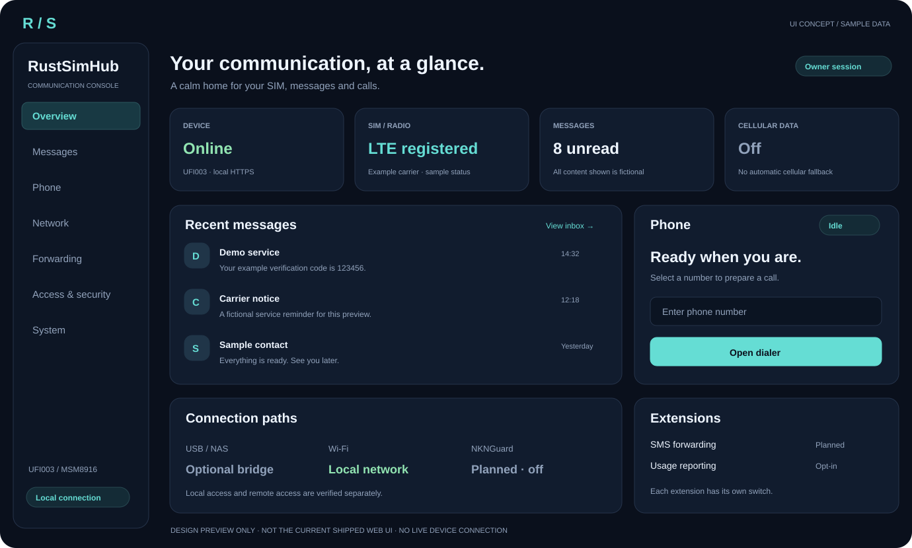
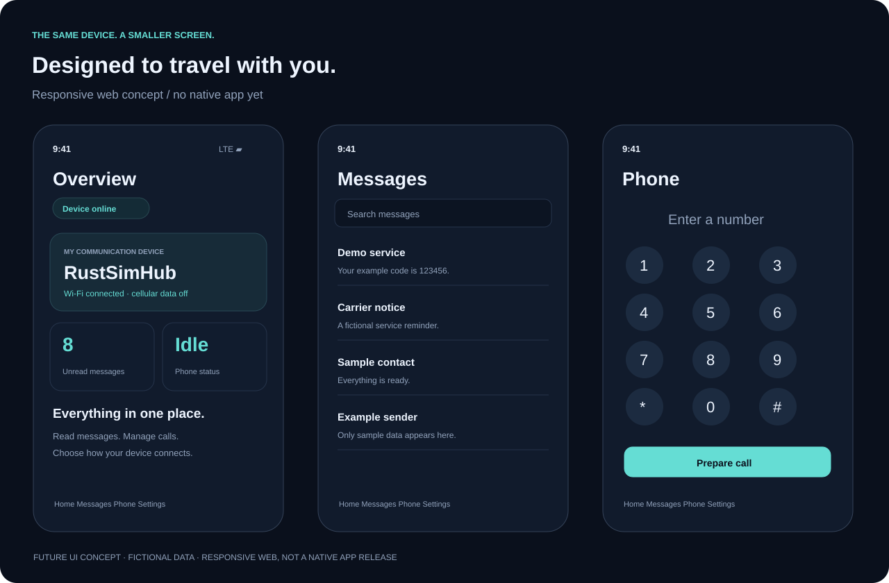

# RustSimHub 前端设计愿景

日期：2026-10-24。状态：**设计提案，未实现此视觉界面**。当前网页位于 `crates/edge/src/web/`。本次交付介绍文档、可编辑 SVG 和生成脚本。

## 产品方向

打开页面就知道设备能否通信、有没有新短信、电话是否空闲、正在使用哪条网络。日常功能在首页可见，维护与调试放在独立页面。



## 页面规划

| 页面 | 主要内容 | 关键交互 |
| --- | --- | --- |
| 总览 | 设备状态、SIM 注册、未读短信、电话、网络路径 | 进入收件箱、打开拨号盘；刷新仅查询 |
| 短信 | 列表、正文、撰写、回执、回收站 | 发送前确认；Unknown 时核对结果，禁止自动重发 |
| 电话 | 拨号、来电、接听、拒接、挂断、静音、DTMF | 按需申请麦克风；声音连接与电话状态分别显示 |
| 网络 | USB / Wi-Fi / 蜂窝、选网、月流量与限额 | 选中 SSID 只填表；试连、保存、确认分步呈现；蜂窝独立授权 |
| 转发 | 总开关、规则、渠道、队列与错误 | 默认关闭，隐藏凭据；结果不明禁止盲目重试 |
| 访问与安全 | Owner、客户端、scope、会话与撤销 | 远程连接成功不等于取得业务权限 |
| 系统 | 版本、更新、恢复、脱敏诊断 | 显示安装、确认和回退；候选包不视为运行版本 |

NKNGuard 放在网络 / 远程接入区域，使用统计放在单独的隐私设置区域。两者与转发各有开关，不互相隐式启用。功能未交付时显示“开发中”及不可用原因。

## 手机端



建议桌面约 1200 px 起采用侧栏与多列卡片，平板约 768–1199 px 两列，手机小于 768 px 单列与底部导航。实际断点按真实内容验证。

底部导航为“总览 / 短信 / 电话 / 设置”。通话中保留可见挂断入口；键盘弹起不能遮挡短信确认和取消按钮。桌面短信页可用列表 / 正文双栏，手机使用分层返回导航。

## 视觉规范

| 项目 | 设计方向 |
| --- | --- |
| 背景 / 卡片 | `#0A101C` / `#111C2E` |
| 边框 / 圆角 | `#25334A` / 12–18 px |
| 主文字 / 次文字 | `#EEF5FF` / `#91A2BB` |
| 主操作 / 正常 | `#65DDD4` / `#92E5B2` |
| 危险操作 | 单独红色及明确文字 |
| 字体 | 中文系统字体优先，不加载在线字体 |
| 可访问性 | 建议触控目标至少 44×44 px，支持键盘、可见焦点与屏幕阅读器 |

用留白和文字层级建立秩序。状态同时使用颜色和文字；图表补单位、窗口和无数据说明；未知显示“未知 / 暂不可用”，不填零。

## 必须保留的交互状态

| 状态 | 应呈现的内容 |
| --- | --- |
| 未配对 / 会话失效 | 可信认领或重新登录，保留必要草稿 |
| 加载 / 提交中 | 标明具体动作，限制重复提交 |
| 离线 / 过期 | 最近成功时间，缓存不能伪装为实时数据 |
| 权限不足 | 说明设备权限；授权仍由 Core 执行 |
| 结果不确定 | 保留操作标识，提供核对入口，不自动重试短信或拨号 |
| 换卡 / 撤销 / 重连 | 按 Core 的 SIM 代次、授权和事件更新 |
| 扩展关闭 | 停止对应后台任务，不自动查询 |

实际接线复用签名身份、短期会话、租约与持久防重。UI 不自动发测试短信、拨号、扫描或切网。

## 实施与验收

1. 整理现有 DOM / 事件绑定与夹具，保留当前测试首页行为。
2. 先做只读总览与响应式布局，再迁移短信、电话和网络，按真实 API 能力开放。
3. 扩展页面等待后端及服务关闭行为验收后接线。
4. 验证窄屏、长中文短信、键盘、权限拒绝、断线、换卡、注销竞争和 Unknown 核对。
5. 运行现有网页回归；真实发送、电话、切网另按授权和实机验收执行。

## 素材与重建

图内短信、时间、数量和网络状态均为虚构样例，不含真实号码、SIM 标识、凭据或日志。英文用于视觉排版，正式界面中文优先。

```sh
python docs/assets/generate-preview.py
```

脚本仅依赖 Python 标准库，生成横幅、桌面和手机三个 SVG。素材为静态设计稿，不是交互原型，不依赖设备接口、外部脚本或在线字体。
