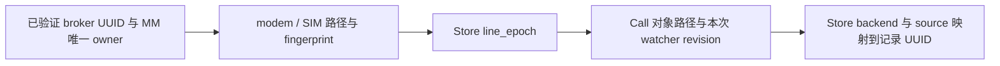

# CALL-08：通话重观察的身份边界与后续提案

2026-10-28，主线接回 D-09～D-12 的离线交付材料。实现截面 `adb7bb6e1598e1a2a5a130821c996733d19c4e65`。**最小防串线修复已实现；本文件的持久身份方案未实现、未批准，不构成完整 CALL-08 验收。**

## 目前真实身份链

- Store 的唯一键是 `(backend,source)`；Core `read_live` 构造 `source = path#revision`。这个 revision 来自本次 watcher，不是 ModemManager 提供的跨进程持久 Call ID。
- Core 的 `live` 内存映射在持续观察时保留该对象最初的 revision。普通唤醒或其他 SMS 事件不会自动生成新通话；匹配路径退休才按新代次保留另一条记录。
- 同号码、同方向、同终态本身不证明物理同一通话；backend/来源代次不同应保留不同 UUID。
- Store 重开会把原 observed 标成 reconciling，不凭空把活动通话改为 ended。若调用方仍有可靠的相同 source，重新确认可以恢复同 UUID 的可用性；这个状态变化可以产生一条 changed 事件，但不能新造活动行。
- `live` 丢失、watcher 重建或观察间隙后，没有证据证明旧路径未被复用；不能把“Store 能复用同 source”写成“所有跨启动情况都已去重”。

## 本次已证实并修复的 Store 缺陷

序列：SIM A Ready → backend/source 对应活动通话 A → 换为 SIM B，但 backend 字符串不变 → B 碰巧给出相同 source、号码和方向，state=7。

旧实现只按 backend/source 找行，直接更新 A 的 state/availability，并为 A 的 ID 写入 B line_epoch 的事件，导致历史串线。新增复现测试在修复前失败。

修复在更新旧行前核对其持久 `line_epoch` 和 `fingerprint` 与当前已验证 binding 一致；不一致返回 `StaleLine`，不改历史行或事件。真实新来源可以创建当前卡的新行。没有修改 schema、通话控制、媒体、租约或幂等键。

**限制：** 来源命名碰撞时，拒绝写入优先于错误关联；本修复不会自动给碰撞的来源猜一个身份，也不承诺该情况下立即恢复完整通话展示。调用方需要新代次的可信身份或明确的不确定记录策略。

## D-10 的已执行矩阵

| 场景 | 实际入口与结果 |
|---|---|
| 8 个并发终止观察，随后重复16次 | 真实 Store 单writer：1个UUID、1条observed事件 |
| 同号码但不同 source | 2个独立UUID，不按内容或终态猜合并 |
| unavailable 重复、数据库重开、可靠 source 再确认 | 原UUID和终态保持；重复 unavailable/确认不重复副作用 |
| backend 实例变更 | 相同来源字符串仍保留新的独立记录 |
| 换SIM、旧异步binding与跨卡来源碰撞 | 拒绝；旧行、历史事件、原状态不被新卡重写 |
| SQLite call_events 插入失败 | 新行插入与终态更新均回滚；修复后重读仍使用原ID |
| 真实 Core + 私有peer，同一终态反复 refresh | 原ID/事件数不变；没有Create/Start/Accept/Hangup调用 |
| 私有peer收到无关 SMS 通知 | 通话身份不变；实际 CallDeleted 后同路径的新代次保留第二行 |

复用本仓库既有的断连/列表异常不可用、换代、权限和通话控制失败测试；本轮新增 4 个 Store 测试和 1 个 Core peer 测试。全部仅用合成数据，未连接系统 D-Bus 或硬件。

## 尚未批准的持久身份方案

必须分开两件事：业务记录的持久身份，与当前进程中执行控制所需的活对象证明。历史 UUID 不能充当当前对象/权限/租约证明；旧 watcher revision 不能直接搬到新 watcher。

待决定的方案有两类：

1. 引入持续运行且可证明观察连续性的适配层，持久保存完整 backend/line/对象代次映射。需要定义丢事件、daemon restart、存储失败及资源成本；只有连续性被证明的部分才可自动关联。
2. 对观察间隙保留新的不确定记录和“可能相同”边，展示历史候选供核对；不自动合并、不伪报新来电，也不隐藏离线期间可能发生的真实来电。这需要明确可用性/未读策略及候选DTO。

两者均不能仅依靠号码、时间接近或同终态。若需新增持久映射/候选边，应先提交具体 schema 迁移、读写/回退兼容、备份恢复及失败样例，经主线审核后实现；本轮没有提升 schema 或对外冻结新 ABI。

后续验收必须覆盖：观察持续与中断两种情况、同路径同号码的新通话、MM重启、Core重启、换SIM、库恢复、重复/丢失通知、终态与未读事件数量，以及真实 MM 的身份可用性证据。当前只能接受本轮最小边界修复和已明确的离线验证范围，**CALL-08 仍未闭环**。
