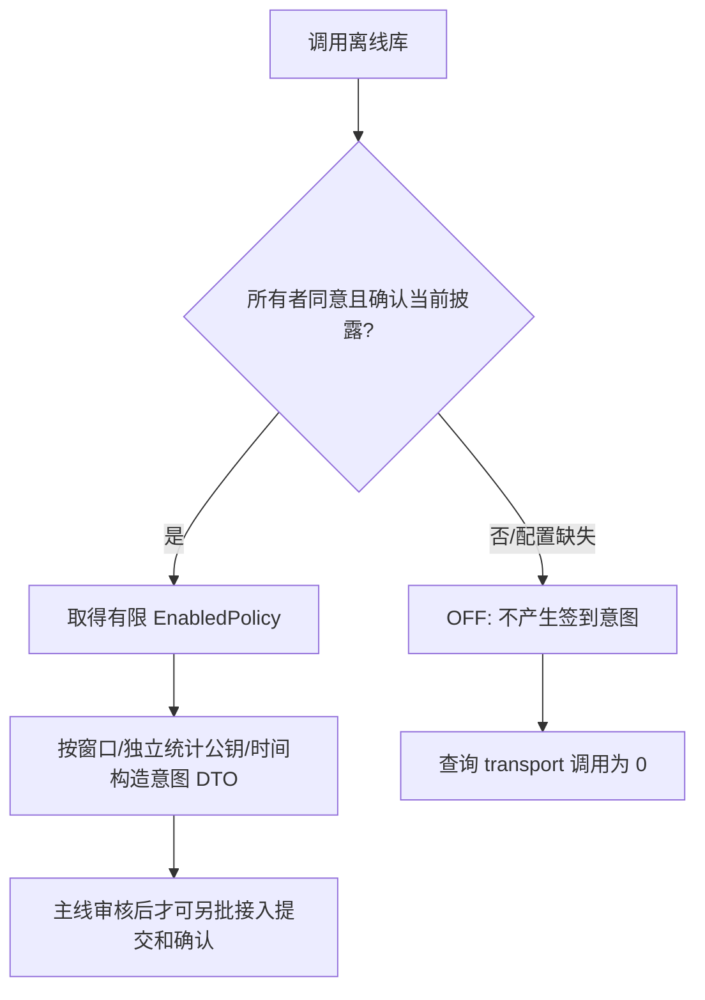
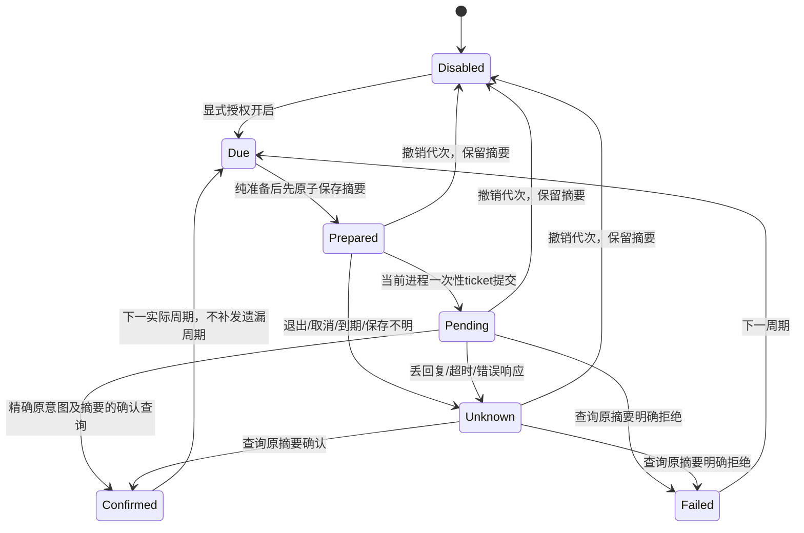

# 第一批契约、查询结果与持久边界

后续A-05～08候选实现已新增`check_in`模块，实际行为和验证见文末。本节保留第一批原始边界的历史说明；新模块仍没有真实NKN SDK、Core授权或生产接线。

这是 A-01～A-04 的实际离线组件边界。第一批没有 A-05 的运行状态机，没有签到执行器、NKN 提交/确认 transport、后台调度器或服务进程。`CheckInIntent` 是纯数据，不代表 Prepared、Pending 或 Confirmed。

## 默认 OFF 的调用顺序

OFF 路径不创建统计密钥、持久文件、队列或定时任务，不读取时钟，也不调用查询 transport。库不自动打开数据目录；身份与文件存储后端由调用方显式创建。显式调用身份生成 API 本身不是统计策略入口，主线须把它放在所有者授权之后。

## 查询与缓存

`QueryClient::new(transport, clock, cache)` 验证给定 `QueryCache` 后只持有这三个对象，不创建密钥、目录、线程、任务或网络请求。`query_window(&policy, window)` 显式查询一个窗口，`query_all(&policy)` 按 `Window::ALL` 顺序查询三个窗口并返回 `[QueryOutcome; 3]`。OFF 时连时钟也不读取。构造函数不验证实际 Owner，调用方须提供正确授权的策略。

三个窗口各自保存成功值、观察时间、成功时间、有效期和 `QuerySource::ReadOnlyTransport`；某窗口失败不会把另外两个窗口清空。只有严格通过解析和契约校验的响应才能更新成功缓存。查询错误不写入 0；`count = 0` 必须来自真实成功响应。这里“成功”指该 transport 返回的响应通过本地验证，不是链上交易确认或对公网结果真实性的背书。

| 情况 | 应展示的语义 |
| --- | --- |
| 查询成功且值为 0 | `Success { entry }`：0 个近期活跃安装 |
| 查询成功且值大于 0 | `Success { entry }`：计数与原观察/本次成功时间 |
| 查询失败且无历史 | `Unknown { reason }`：未知，附有限错误分类 |
| 查询失败且存在历史 | `Cached { entry, freshness, reason }`：缓存和原时间，附本次错误 |
| 距同窗口上次查询开始不足 5 秒 | `Throttled` 原因；有历史则缓存，无历史则未知；不调用 transport |
| 时间回拨 | `ClockRollback`；撤销所有已有条目的新鲜资格，不将旧缓存重新变新 |
| OFF | `Disabled`；transport 和时钟调用数为 0 |

这是显式刷新 API：超过最短间隔后，每次 `query_*` 都尝试 transport，未实现上游“TTL 内普通读取自动命中缓存、force 另行刷新”的接口。`cache().entry(window)` 允许只读检查历史；`CacheEntry::freshness(now)` 只分类历史，不产生新成功时间。`Freshness` 为 `WithinTtl`、`Expired` 或 `ClockRollback`；即使 TTL 内遇到网络失败，也必须保留失败原因，不能伪装成新的成功。已过期缓存仍可作为明确标旧的历史展示，不是有效当前计数。

`QueryCache` 保存时间高水位 `high_water_secs`、三个可选 `CacheEntry` 和各窗口上次尝试时间。观察到 `now < high_water_secs` 会把全部已有条目 `freshness_revoked` 置为真；即使时钟追平，旧条目也不会自动重新变新鲜，只有通过新响应才能替换。不能用负数年龄或重置成功时间将旧结果标为 Fresh。高水位是可注入时间源的本地保护，不是可信网络授时或绝对实时时间证明。缓存和只读查询不需要统计私钥。

`QueryClient` **不自动持久化**。主线必须在每次查询后，包括失败、限频和回拨结果，将 `cache().clone()` 写回 `StoredState.cache` 并调用 `FileStore::save`；也可用 `into_parts()` 收回 transport、clock 和缓存。成功保存后重开才能恢复同一高水位与撤销标志。保存失败必须单独报告，不能声称刚更新的回拨标志已跨重启保存，不能丢弃错误后继续对外宣称结果可靠。

查询接收的是合成或由后续适配器生成的有限页面，限制单次字节数、页面数和计数上限；拒绝重复字段、重复页面、窗口/主题不符、溢出、过大结果及过期响应。响应不能控制目标 URL、命令或读取路径。第一批没有包含真实 RPC 传输的自动回退。

## 持久格式

`FileStore` 是实际文件后端，用于临时目录回归和后续主线集成，不能用进程内 map 代替跨重启保存。`FileStore::create(path, identity)` 只接受新目录，父目录须已存在；`open(path, expected_public_key)` 只打开已有存储并核对预期公钥，不生成身份。`identity()` 仅提供身份对象的受限 API；`load()` / `save(&StoredState)` 读写同一保护目录。

私有 `state.json` 上限为 128 KiB。外层字段为 `format_version = 1`、`product_domain`、`public_key`、本地私有 `seed` 和 `state`。`StoredState` 保存 `disabled_generation`、按固定顺序排列的三个 `WindowState` 及 `cache`。每个窗口保存 `window`、可选 `period`、`pending`（32 字节非零摘要及 `prepared_at`）和 `last_success`（周期及 `confirmed_at`）。这些预留记录不意味着第一批已运行提交/确认状态转换。载入时验证版本、产品/身份绑定、字段、大小、窗口唯一顺序、周期和缓存约束；未知/重复字段失败。

缺失文件与损坏文件是不同结果。短文件、未知版本、身份/产品不匹配、权限错误或链接错误必须显式失败，保留原文件；不能通过生成新身份、清空待确认摘要或覆盖文件掩盖损坏。`save` 先重新验证已有文件，不能用手中缓存身份覆盖已损坏的文件。写入使用同目录受限临时文件、完整写入和文件同步后原子发布；成功只代表本地持久化完成，不代表链上成功。发布后若目录同步失败，方法仍返回错误，但新状态可能已可见；调用方应重开核验，不得把所有保存错误解释为“肯定没有保存”。

Linux 后端逐级 `openat` 拒绝跟随链接，要求数据目录 0700、当前有效 UID，文件 0600、当前有效 UID、普通文件且单个硬链接。`writer.lock` 的生命周期独占锁防止两个正常调用者同时写入，并核对锁文件与原句柄的设备/ inode；文件发布后同步目录。Windows 后端实际执行文件写入、文件同步、重命名及锁，拒绝已观察到的 reparse point，但只继承调用方 ACL，没有 Linux 的 owner/mode、同等路径替换保护和目录 fsync 保证。**Windows 生产私有存储安全未验收**；其他平台返回 `UnsupportedPlatform`。平台相关测试在交付报告中按实际运行记录，不把 Windows 测试当作 Linux 权限/链接验收。

## 下一批才实现的状态机

任务书的 `Disabled → Due → Prepared/Pending → Confirmed/Failed/Unknown` 属于 A-05；A-06 的取消代次、旧回复隔离和共享引擎资源所有权也未实现。本批没有“模拟成功”API 替代这些缺口。下一批必须证明先持久意图再允许提交；结果不明时保留原摘要，重开只查询原交易，不能生成新交易绕过防重。

真实 SDK、链上确认、服务/IPC、Core 所有者鉴权、Root/ARM/设备验收全部保留给后续审核与主线接入。本批不声称 OFF 后设备无 PID，也不把删除本地状态当作撤回公开订阅；历史链上订阅可能在实际链上到期前继续可见。

## A-05～08：实际有界状态机候选

`CheckInMachine::new(store,transport,clock)`只持有显式提供的已有store/端口，不读取时钟/文件、不生成身份、不启动线程/任务。配置缺失默认OFF；`advance(window)`在OFF下为Disabled且没有存储/时钟/transport调用。真实Owner鉴权仍由宿主提供`EnabledPolicy`；组件不会自行生成同意，不接受URL、shell、密钥路径或Owner/SIM身份。

公开方法只有构造、有限预算、取取消句柄、set_policy及advance。每次advance至多执行一次prepare/submit/query，不自循环。第一次Due只让adapter纯准备真实交易并取得其摘要，写入实际FileStore v1已有的period/pending后返回Prepared；本进程再次显式advance才能消费一次性ticket提交。取走ticket发生在外部submit之前，提交Ok只得到Pending，任何提交错误均Unknown。没有真实adapter时不能伪造交易摘要/链上成功；测试摘要明确为合成值。这里未增加私钥导出或自造NKN签名格式。

重启、重新开启、取消、旧ticket、跨周期或ticket到期均失去提交能力。只要pending存在，就只查询原摘要，绝不再次prepare/submit、改nonce生成新交易或因过期清掉防重记录。确认查询严格匹配完整公开意图（公钥/主题/窗口/周期/协议/订阅参数）及32B摘要；最大2048B、拒绝重复/额外字段/未知状态。匹配JSON仅证明本地校验，真实SDK/链上证据来源仍由实际adapter负责。

v1格式及字段不变：pending+period保留不确定意图，last_success只在精确确认查询且保存成功后记录。明确拒绝清pending但保留已消费period，该周期不再尝试；成功后的后续周期最多准备当前周期，不补发遗漏的每日交易。旧缓存不受签到保存/禁用影响。任一保存错误（包括发布成功但目录同步报错）使当前句柄失败关闭，清ticket并释放自身引用；必须drop后重开核对原文件，不能假定肯定未保存并再次提交。原文件损坏/权限/身份错误保持原样，不生成新身份。

每个步骤共享最多10秒单调截止，adapter须在I/O中遵守`AttemptBudget`；模块也在返回后核验实际经过时间及墙钟差/回拨。可显式缩短预算用于受限宿主/测试，不允许延长。新ticket仅在原prepare截止前且同一实际周期内有效。查询/准备失败按窗口至少退避300秒；三个窗口独立。未决超过24小时显示ExpiredUnresolved但仍保留摘要；这是本地等待标记，不是链上过期证明。退避计时在进程内，重开后至少遵守原prepared_at+300秒；没有跨进程持久查询次数配额，宿主须保持单实例且不得通过重启滥用只读查询。无自动调度/退避重试线程。

`Cancellation::cancel`使当前代次失效，外部调用返回后不再采纳其确认；确认保存与取消用同一短临界区排序，不在transport调用期间持锁。取消线程不自行执行I/O，但可能等待已经开始的本地文件提交完成；它不是硬实时中断。驱动步骤或显式set_policy(disabled)随后保存disabled_generation+1、清ticket并释放自己的统计引用，保留全部pending。进程在同步代次前崩溃也不会重新提交，因为恢复总是query-only且默认OFF；不能把内存取消句柄说成已经持久化开关。

只有组件能创建不可Clone的StatisticsLease。获取/部分获取失败、禁用、错误和Drop只释放本统计拥有者引用；端口没有关闭共享引擎/他人会话的通用stop。真实Root/cgroup/设备无PID仍未验证。释放端口必须是有限的本地引用清理；真实adapter负责执行其约定，库不能强制终止一个无视deadline的同步外部调用。

真实测试调用这份生产模块与真实临时FileStore；fault wrapper只在文件提交前/后注入保存错误，不复制状态机。覆盖全部三窗口、保存后才submit、退出恢复、拒绝/失联、时钟/预算、额外/错意图/重复/超量回复、取消和旧代次、部分资源获取/其他拥有者保留、代次溢出、完整快照并发读取。尚无NKN公网上链或真实取消进程验证；不能把这些测试当成公开订阅已撤销或统计功能已上线。
